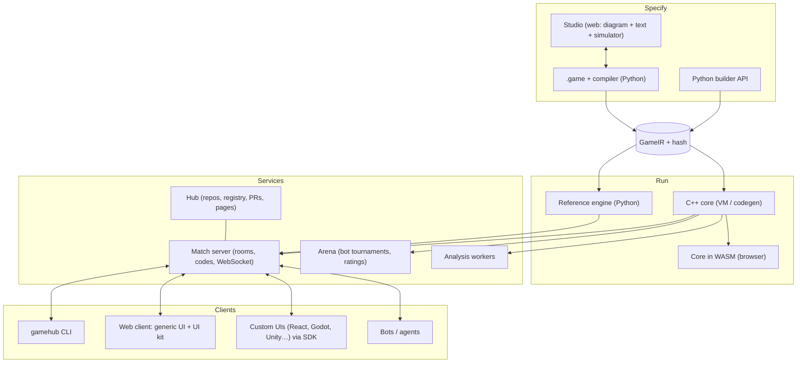

# Architecture

> Status: **proposal v0.1** (Phase 0), implemented progressively since Phase 1. Technology
> choices are recorded in [decisions](decisions.md).

## 1. Overview



## 2. Monorepo layout

> **Status (2026-10-16, Phase 6):** there are `spec/` (IR v0, protocol v1, conformance traces),
> `python/` (the `gamehub` package: the Nomos language, validation, analysis, the engine with
> native plugins, renderers, packages, protocol, match server, client SDK, LSP, Studio, CLI and the
> UI template), `web/` (TypeScript SDK, UI kit, generic UI, the play app and the Studio), `stdlib/`
> (9 modules and the plugins in `stdlib/std/native`), `games/` (22 packages with 23 games; seven
> with a custom UI in `games/<game>/ui`), `editors/vscode/` and `docs/`. The JavaScript side is a
> pnpm workspace at the root (`package.json`, `pnpm-workspace.yaml`, `biome.json`). The remaining
> directories are created in the phase that needs them.

```
GameHub/
├── spec/                  # Source of truth for the contracts
│   ├── ir/                # JSON Schema of the GameIR
│   ├── protocol/          # JSON Schema of the protocol messages
│   └── conformance/       # Golden traces every engine must reproduce
├── python/src/gamehub/    # Python package (pip install gamehub)
│   ├── lang/              # Nomos: lexer, parser, AST, types and translation, modules, mods,
│   │                      #   combinators, formatter, decompiler, test runner
│   ├── ir/                # schema, operator catalog, validation, canonical hash
│   ├── build.py           # Python builder API → IR
│   ├── engine/            # reference engine (IR interpreter, generated code, native plugins)
│   ├── analysis/          # static warnings and classification (F2), perft (F6); feasibility, tree, solvers…
│   ├── render/            # flow diagram, rulebook and semantic diff (F2)
│   ├── packages.py        # game.toml, game.lock, dependencies, new/clone/fork (F2)
│   ├── agents/            # Agent interface, random, minimax, MCTS, heuristics
│   ├── protocol/          # protocol v1: message validation and generated types (F3)
│   ├── server/            # rooms (pure core), Starlette transport, LAN/mDNS, SQLite (F3)
│   ├── client/            # Python client SDK, network bots, terminal client (F3)
│   ├── lsp/               # Nomos language server (pygls): gamehub lsp and the Studio's (F5)
│   ├── studio/            # the Studio: server, session, tree edits, model, simulator,
│   │                      #   workspace (F5)
│   ├── templates/games/   # game templates (gamehub new --template and the Studio)
│   ├── interop/           # OpenSpiel, Gambit, PettingZoo, PGN…
│   └── cli.py             # gamehub check|fmt|test|viz|rules|diff|new|play|perft|serve|host|join|rooms|bot|studio|lsp|natives|…
├── core/                  # C++20: VM, compact state, algorithms, bindings, WASM
├── web/                   # TypeScript (pnpm workspace at the root, F4)
│   ├── packages/protocol  # types generated from spec/protocol
│   ├── packages/client    # TS client SDK (connection, state, REST)
│   ├── packages/i18n      # Spanish and English
│   ├── packages/react     # React hooks on top of the SDK
│   ├── packages/ui-kit    # cards, hands, decks, boards, dice, tokens, clocks
│   ├── packages/auto-ui   # generic UI from the IR
│   ├── packages/shell     # the play experience as a library (rooms, lobby, replays…)
│   ├── packages/nomos     # Nomos for CodeMirror (highlighting, indentation, folding, theme)
│   ├── packages/studio    # the Studio as a library (diagram, editors, inspector, simulator)
│   ├── apps/play          # the web app (served by gamehub serve)
│   ├── apps/studio        # the Studio app (served by gamehub studio, F5)
│   └── apps/hub           # the hub's website (later)
├── stdlib/std/            # .game modules: cards, dice, grid, graph, boards, tricktaking, bidding,
│                          #   betting, poker; native/ = WebAssembly plugins (.wat and .wasm)
├── games/                 # Official catalog: one package per game (game.toml, .game with its tests,
│                          #   ui/ = optional custom React UI)
├── editors/vscode/nomos/  # VS Code extension (highlighting, diagnostics, formatting)
├── docs/wiki/             # This wiki
└── log.md
```

**Game package** (what gets cloned/published):

```
wizard/
├── game.toml          # name, version, authors, license, dependencies (std >= 0.3)
├── wizard.game        # rules (can be split across several files/modules)
├── wizard.layout.json # diagram positions (optional)
├── tests/             # .game scenarios and golden traces
├── heuristics/        # heuristics and bots (optional)
├── ui/                # custom interfaces (optional)
└── README.md          # + generated rulebook
```

## 3. The engine contract (Game API)

Every engine (Python, C++, WASM) implements **the same interface**, verified by the
[conformance traces](../../spec/conformance). It is deliberately close to OpenSpiel so that the
bridge is trivial. Implemented in the reference engine (Phase 1, details in [engine](engine.md)):

```python
class Game:
    id, version, title, rules_hash, players            # (min, max)
    def new_state(self, num_players=None, params=None) -> State: ...

class State:                                           # IMMUTABLE: every step returns another state
    status: Status                                     # CHANCE | DECISION | TERMINAL
    active_seats: tuple[int, ...]
    payoffs: tuple | None
    def legal_actions(self, seat) -> list[Action]
    def options(self, seat, name=None, args=None) -> list   # progressive building
    def apply_action(self, seat, action) -> State
    def chance_outcomes(self, limit=100_000) -> list[tuple[Outcome, Fraction]]
    def sample_chance(self, rng: Pcg32) -> Outcome
    def apply_chance(self, outcome) -> State
    def view(self, seat | None) -> dict                # None = omniscient
    def events(self, seat | None) -> list[dict]        # events of the last step
    def information_state(self, seat) -> str           # key of the information set
    def snapshot(self) -> dict;  def digest(self) -> str
    def history(self) -> list[Step];  def decode_action(self, seat, json) -> Action
```

The **match loop is not in the engine**: the *drivers* provide it (`play_match`, `fuzz`, the CLI,
the server, the Studio's simulator, the RL trainer, tournaments).

## 4. Technology stack

| Area | Choice | Reason | Alternatives |
|---|---|---|---|
| Python | 3.12+, `uv`, `ruff`, `pyright`, `pytest`, `hypothesis` | Modern and quick to iterate | poetry |
| Parser | Hand-written recursive descent for Nomos (F2, [ADR-027](decisions.md)); **tree-sitter** later for editors | Precise errors and recovery; multi-language later | Lark, ANTLR |
| Contracts | JSON Schema → `TypedDict` (Py) and `interface` (TS), generated ([ADR-045](decisions.md)) | A single definition | protobuf |
| Server | **Starlette + uvicorn + websockets** (F3, [ADR-036](decisions.md)) | Async and lightweight; contracts in JSON Schema | FastAPI, aiohttp |
| Local persistence | SQLite | Zero configuration | — |
| Native plugins | **WebAssembly** without imports, `wasmtime` in Python (F6, [ADR-062](decisions.md)) | The same binary in Python, the browser and C++; sandboxed | Python plugins, shared libraries |
| C++ | C++20, CMake, **nanobind**, Catch2 | Speed + lightweight bindings | pybind11 |
| Browser | Emscripten (C++ core → WASM) | The same engine everywhere | Pyodide (stopgap) |
| Web | TypeScript 7, React 19, Vite 8, pnpm, Biome, Vitest (F4, [ADR-044](decisions.md)) | Ecosystem; Biome is JS's ruff | Svelte; ESLint + Prettier |
| Diagrams | React Flow (`@xyflow/react`) + ELK.js (F5, [ADR-055](decisions.md)) | The standard for node editors + auto-layout | Rete.js, JointJS, dagre |
| Text editor | **CodeMirror 6** + LSP (`pygls`) (F5, [ADR-053](decisions.md), [054](decisions.md)) | Lightweight, dozens of fields per page, official LSP client | Monaco |
| Analysis | NumPy, SciPy (HiGHS), `pygambit`, OpenSpiel | Don't reinvent solvers | — |
| RL | PyTorch, Gymnasium, PettingZoo | Standard | JAX |
| Hub | FastAPI + PostgreSQL + S3/MinIO + **Forgejo** (git) | Don't reinvent git | Gitea, our own git |

## 5. Quality strategy

| Level | What | Tool |
|---|---|---|
| Unit | Language, expressions, effects, visibility | pytest / Catch2 / vitest |
| Rule scenarios | `test` blocks inside each game | `gamehub test` |
| Properties | Invariants (`invariant total_cards == 52`), random playouts without errors | hypothesis + our own fuzzer |
| Golden traces | Same seed + actions ⇒ same events, views and payoffs | `spec/conformance/` |
| Differential | Python vs C++ vs WASM over millions of playouts | conformance runner |
| External references | Chess *perft* (F6), ISkO examples (Skat), Kuhn's value (−1/18), tic-tac-toe = draw | analysis tests and each game's tests |
| Native plugins | Plugin = Nomos reference on random inputs | `gamehub natives check`, tests |
| Information leaks | No view contains non-visible data | static analysis + view tests |

## 6. Security

- Rules are **data**: running an unknown game on the server is safe by design (step and memory
  limits against abuse).
- **Native plugins** (the poker hand evaluator, F6, [ADR-062](decisions.md)): pure functions marked
  `@native`, in **WebAssembly without imports** (no files, no network, no clock) and with a
  computation limit per call; always with the reference implementation in Nomos, which is the one
  that rules (`gamehub natives check` compares them).
- **Authoritative server:** the client only receives its redacted view; never the full state.
- **Local Studio** ([ADR-057](decisions.md)): only on 127.0.0.1 by default, random token, Host and
  Origin checked (against DNS rebinding and other pages in the browser), and only `.game` files
  in the working directory.
- Third-party bots: in a separate process / container / WASM, with CPU, memory and time limits.
