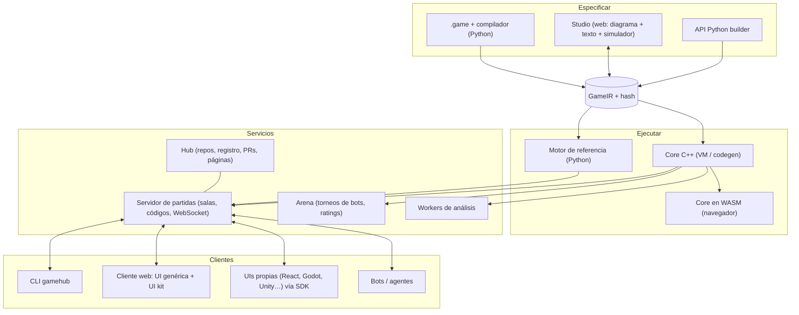

# Arquitectura

> Estado: **propuesta v0.1** (Fase 0). Las elecciones tecnológicas marcadas como *propuesta* están
> pendientes de confirmación en [decisiones](decisiones.md).

## 1. Vista general



## 2. Estructura del monorepo (propuesta)

> **Estado (2026-10-09, Fase 2):** existen `spec/` (IR v0, trazas de conformidad), `python/`
> (paquete `gamehub`: lenguaje Nomos, validación, análisis, motor, presentaciones, paquetes y CLI),
> `stdlib/` (biblioteca estándar de Nomos), `games/` (15 paquetes con 16 juegos), `editors/vscode/`
> (extensión de VS Code) y `docs/`. El resto de directorios se crea en la fase que los necesita.

```
GameHub/
├── spec/                  # Fuente de verdad de los contratos
│   ├── ir/                # JSON Schema de la GameIR
│   ├── protocol/          # JSON Schema de los mensajes del protocolo
│   └── conformance/       # Trazas doradas que todo motor debe reproducir
├── python/src/gamehub/    # Paquete Python (pip install gamehub)
│   ├── lang/              # Nomos: lexer, parser, AST, tipos y traducción, módulos, mods,
│   │                      #   combinadores, formateador, descompilador, ejecutor de tests
│   ├── ir/                # esquema, catálogo de operadores, validación, hash canónico
│   ├── build.py           # API Python builder → IR
│   ├── engine/            # motor de referencia (intérprete de la IR)
│   ├── analysis/          # avisos estáticos y clasificación (F2); viabilidad, árbol, solvers…
│   ├── render/            # diagrama del flow, reglamento y diff semántico (F2)
│   ├── packages.py        # game.toml, game.lock, dependencias, new/clone/fork (F2)
│   ├── agents/            # interfaz Agent, aleatorio, minimax, MCTS, heurísticas
│   ├── server/            # salas, protocolo, LAN, relojes, persistencia
│   ├── client/            # SDK cliente Python (humanos y bots)
│   ├── interop/           # OpenSpiel, Gambit, PettingZoo, PGN…
│   └── cli.py             # gamehub check|fmt|test|viz|rules|diff|new|play|… (host, join, analyze, studio: después)
├── core/                  # C++20: VM, estado compacto, algoritmos, bindings, WASM
├── web/                   # Monorepo TypeScript (pnpm)
│   ├── packages/protocol  # tipos generados desde spec/protocol
│   ├── packages/client    # SDK cliente TS
│   ├── packages/ui-kit    # cartas, manos, mazos, tableros, dados, fichas, relojes
│   ├── packages/auto-ui   # UI genérica a partir de la IR
│   ├── apps/studio        # editor visual
│   ├── apps/play          # lobby + partida + replays
│   └── apps/hub           # web del hub (más tarde)
├── stdlib/std/            # Módulos .game: std.cards, std.dice, std.grid, std.graph (después: std.tricktaking…)
├── games/                 # Catálogo oficial: un paquete por juego (game.toml, .game con sus tests, ui/)
├── editors/vscode/nomos/  # Extensión de VS Code (resaltado, diagnósticos, formato)
├── docs/wiki/             # Esta wiki
└── log.md
```

**Paquete de juego** (lo que se clona/publica):

```
wizard/
├── game.toml          # nombre, versión, autores, licencia, dependencias (std >= 0.3)
├── wizard.game        # reglas (puede repartirse en varios archivos/módulos)
├── wizard.layout.json # posiciones del diagrama (opcional)
├── tests/             # escenarios .game y trazas doradas
├── heuristics/        # heurísticas y bots (opcional)
├── ui/                # interfaces propias (opcional)
└── README.md          # + reglamento autogenerado
```

## 3. El contrato de motor (Game API)

Todos los motores (Python, C++, WASM) implementan **la misma interfaz**, verificada por las
[trazas de conformidad](../../spec/conformance). Es deliberadamente parecida a OpenSpiel para que el
puente sea trivial. Implementada en el motor de referencia (Fase 1, detalle en [motor](motor.md)):

```python
class Game:
    id, version, title, rules_hash, players            # (mín, máx)
    def new_state(self, num_players=None, params=None) -> State: ...

class State:                                           # INMUTABLE: cada paso devuelve otro estado
    status: Status                                     # CHANCE | DECISION | TERMINAL
    active_seats: tuple[int, ...]
    payoffs: tuple | None
    def legal_actions(self, seat) -> list[Action]
    def options(self, seat, name=None, args=None) -> list   # construcción progresiva
    def apply_action(self, seat, action) -> State
    def chance_outcomes(self, limit=100_000) -> list[tuple[Outcome, Fraction]]
    def sample_chance(self, rng: Pcg32) -> Outcome
    def apply_chance(self, outcome) -> State
    def view(self, seat | None) -> dict                # None = omnisciente
    def events(self, seat | None) -> list[dict]        # eventos del último paso
    def information_state(self, seat) -> str           # clave del conjunto de información
    def snapshot(self) -> dict;  def digest(self) -> str
    def history(self) -> list[Step];  def decode_action(self, seat, json) -> Action
```

El **bucle de partida no está en el motor**: lo ponen los *drivers* (`play_match`, `fuzz`, la CLI,
el servidor, el simulador del Studio, el entrenador RL, los torneos).

## 4. Pila tecnológica (propuesta)

| Área | Propuesta | Motivo | Alternativas |
|---|---|---|---|
| Python | 3.12+, `uv`, `ruff`, `pyright`, `pytest`, `hypothesis` | Moderno y rápido de iterar | poetry |
| Parser | **Lark** (v0) → **tree-sitter** (para editores) | Iteración rápida; luego multi-lenguaje | ANTLR, recursivo descendente a mano |
| Contratos | JSON Schema → `pydantic` (Py) y tipos TS generados | Una sola definición | protobuf |
| Servidor | FastAPI + uvicorn + WebSocket | Async, OpenAPI gratis | aiohttp |
| Persistencia local | SQLite | Cero configuración | — |
| C++ | C++20, CMake, **nanobind**, Catch2 | Velocidad + bindings ligeros | pybind11 |
| Navegador | Emscripten (core C++ → WASM) | Mismo motor en todas partes | Pyodide (provisional) |
| Web | TypeScript, React, Vite, pnpm | Ecosistema | Svelte |
| Diagramas | React Flow (`@xyflow/react`) + ELK.js | Estándar de editores de nodos + auto-layout | Rete.js, JointJS |
| Editor de texto | Monaco + LSP (`pygls`) | Experiencia tipo VS Code | CodeMirror 6 |
| Análisis | NumPy, SciPy (HiGHS), `pygambit`, OpenSpiel | No reinventar solvers | — |
| RL | PyTorch, Gymnasium, PettingZoo | Estándar | JAX |
| Hub | FastAPI + PostgreSQL + S3/MinIO + **Forgejo** (git) | No reinventar git | Gitea, git propio |

## 5. Estrategia de calidad

| Nivel | Qué | Herramienta |
|---|---|---|
| Unitario | Lenguaje, expresiones, efectos, visibilidad | pytest / Catch2 / vitest |
| Escenarios de reglas | Bloques `test` dentro de cada juego | `gamehub test` |
| Propiedades | Invariantes (`invariant total_cards == 52`), playouts aleatorios sin errores | hypothesis + fuzzer propio |
| Trazas doradas | Misma semilla + acciones ⇒ mismos eventos, vistas y pagos | `spec/conformance/` |
| Diferencial | Python vs C++ vs WASM sobre millones de playouts | runner de conformidad |
| Referencias externas | *perft* de ajedrez, valor de Kuhn (−1/18), tres en raya = tablas | tests de análisis |
| Fugas de información | Ninguna vista contiene datos no visibles | análisis estático + test de vistas |

## 6. Seguridad

- Las reglas son **datos**: ejecutar un juego desconocido en el servidor es seguro por diseño
  (límites de pasos y memoria contra abusos).
- **Plugins nativos** (p. ej. evaluador de manos de póker): puros, con firma declarada y
  preferentemente en **WASM** (sandbox en servidor, navegador y C++), siempre con una
  implementación de referencia en el lenguaje para verificarlos.
- **Servidor autoritativo:** el cliente solo recibe su vista redactada; nunca el estado completo.
- Bots de terceros: en proceso separado / contenedor / WASM, con límites de CPU, memoria y tiempo.
