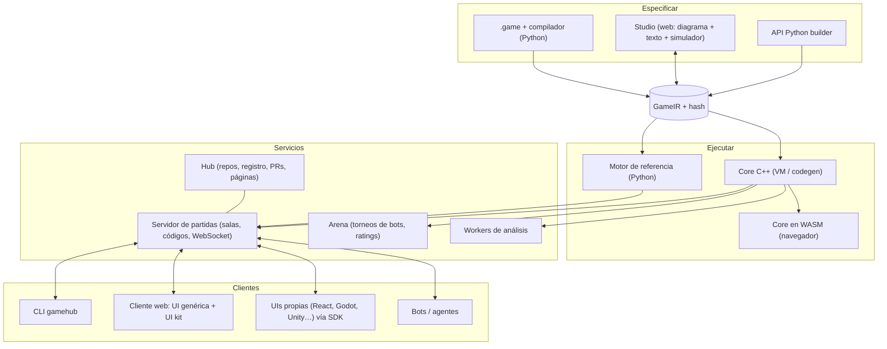

# Arquitectura

> Estado: **propuesta v0.1** (Fase 0). Las elecciones tecnológicas marcadas como *propuesta* están
> pendientes de confirmación en [decisiones](decisiones.md).

## 1. Vista general



## 2. Estructura del monorepo (propuesta)

> **Estado (2026-10-09):** existen `spec/` (IR v0), `python/` (paquete `gamehub`: validación de
> la IR y CLI) y `docs/`. El resto de directorios se crea en la fase que los necesita.

```
GameHub/
├── spec/                  # Fuente de verdad de los contratos
│   ├── ir/                # JSON Schema de la GameIR
│   ├── protocol/          # JSON Schema de los mensajes del protocolo
│   └── conformance/       # Trazas doradas que todo motor debe reproducir
├── python/gamehub/        # Paquete Python (pip install gamehub)
│   ├── lang/              # lexer/parser, AST, resolución, tipos, lowering, formateador, LSP
│   ├── ir/                # modelos pydantic, validación, hash canónico, diff semántico
│   ├── build/             # API Python builder → IR
│   ├── engine/            # motor de referencia (intérprete de la IR)
│   ├── analysis/          # clasificación, viabilidad, árbol, matriz, solvers, CGT
│   ├── agents/            # interfaz Agent, aleatorio, minimax, MCTS, heurísticas
│   ├── server/            # salas, protocolo, LAN, relojes, persistencia
│   ├── client/            # SDK cliente Python (humanos y bots)
│   ├── interop/           # OpenSpiel, Gambit, PettingZoo, PGN…
│   └── cli/               # gamehub new|check|fmt|test|play|host|join|analyze|studio…
├── core/                  # C++20: VM, estado compacto, algoritmos, bindings, WASM
├── web/                   # Monorepo TypeScript (pnpm)
│   ├── packages/protocol  # tipos generados desde spec/protocol
│   ├── packages/client    # SDK cliente TS
│   ├── packages/ui-kit    # cartas, manos, mazos, tableros, dados, fichas, relojes
│   ├── packages/auto-ui   # UI genérica a partir de la IR
│   ├── apps/studio        # editor visual
│   ├── apps/play          # lobby + partida + replays
│   └── apps/hub           # web del hub (más tarde)
├── stdlib/                # Módulos .game: std.cards, std.dice, std.boards, std.tricktaking…
├── games/                 # Catálogo oficial: un directorio por juego (game.toml, .game, tests, ui/)
├── docs/wiki/             # Esta wiki
└── log.md
```

**Paquete de juego** (lo que se clona/publica):

```
wizard/
├── game.toml          # nombre, versión, autores, licencia, dependencias (std >= 0.3)
├── wizard.game        # reglas (puede repartirse en varios archivos/módulos)
├── wizard.layout.json # posiciones del diagrama (opcional)
├── tests/             # escenarios .game y trazas doradas
├── heuristics/        # heurísticas y bots (opcional)
├── ui/                # interfaces propias (opcional)
└── README.md          # + reglamento autogenerado
```

## 3. El contrato de motor (Game API)

Todos los motores (Python, C++, WASM) implementan **la misma interfaz**, verificada por la suite de
conformidad. Es deliberadamente parecida a OpenSpiel para que el puente sea trivial.

```python
class Game:
    info: GameInfo                       # nº asientos, propiedades, hash de reglas/interfaz
    def new_match(self, params: dict, seed: int) -> State: ...

class State:                             # INMUTABLE: apply devuelve un estado nuevo
    def status(self) -> Status           # DECISION | CHANCE | TERMINAL
    def active_seats(self) -> list[Seat]
    def legal_actions(self, seat: Seat, prefix: dict = {}) -> ActionSpace   # + construcción progresiva
    def chance_outcomes(self) -> list[tuple[Outcome, Fraction]] | Sampler
    def apply(self, seat: Seat, action: Action) -> tuple["State", list[Event]]
    def apply_chance(self, outcome: Outcome) -> tuple["State", list[Event]]
    def view(self, seat: Seat | None) -> View          # None = vista omnisciente (depuración)
    def observation(self, seat: Seat) -> Observation   # pública + privada del último paso
    def information_state(self, seat: Seat) -> bytes   # clave del conjunto de información
    def payoffs(self) -> list[Fraction]
    def to_json(self) -> dict                          # notación de posición universal
    def hash(self) -> int                              # Zobrist derivado del esquema
```

El **bucle de partida no está en el motor**: lo ponen los *drivers* (servidor, CLI, simulador del
Studio, entrenador RL, torneo).

## 4. Pila tecnológica (propuesta)

| Área | Propuesta | Motivo | Alternativas |
|---|---|---|---|
| Python | 3.12+, `uv`, `ruff`, `pyright`, `pytest`, `hypothesis` | Moderno y rápido de iterar | poetry |
| Parser | **Lark** (v0) → **tree-sitter** (para editores) | Iteración rápida; luego multi-lenguaje | ANTLR, recursivo descendente a mano |
| Contratos | JSON Schema → `pydantic` (Py) y tipos TS generados | Una sola definición | protobuf |
| Servidor | FastAPI + uvicorn + WebSocket | Async, OpenAPI gratis | aiohttp |
| Persistencia local | SQLite | Cero configuración | — |
| C++ | C++20, CMake, **nanobind**, Catch2 | Velocidad + bindings ligeros | pybind11 |
| Navegador | Emscripten (core C++ → WASM) | Mismo motor en todas partes | Pyodide (provisional) |
| Web | TypeScript, React, Vite, pnpm | Ecosistema | Svelte |
| Diagramas | React Flow (`@xyflow/react`) + ELK.js | Estándar de editores de nodos + auto-layout | Rete.js, JointJS |
| Editor de texto | Monaco + LSP (`pygls`) | Experiencia tipo VS Code | CodeMirror 6 |
| Análisis | NumPy, SciPy (HiGHS), `pygambit`, OpenSpiel | No reinventar solvers | — |
| RL | PyTorch, Gymnasium, PettingZoo | Estándar | JAX |
| Hub | FastAPI + PostgreSQL + S3/MinIO + **Forgejo** (git) | No reinventar git | Gitea, git propio |

## 5. Estrategia de calidad

| Nivel | Qué | Herramienta |
|---|---|---|
| Unitario | Lenguaje, expresiones, efectos, visibilidad | pytest / Catch2 / vitest |
| Escenarios de reglas | Bloques `test` dentro de cada juego | `gamehub test` |
| Propiedades | Invariantes (`invariant total_cards == 52`), playouts aleatorios sin errores | hypothesis + fuzzer propio |
| Trazas doradas | Misma semilla + acciones ⇒ mismos eventos, vistas y pagos | `spec/conformance/` |
| Diferencial | Python vs C++ vs WASM sobre millones de playouts | runner de conformidad |
| Referencias externas | *perft* de ajedrez, valor de Kuhn (−1/18), tres en raya = tablas | tests de análisis |
| Fugas de información | Ninguna vista contiene datos no visibles | análisis estático + test de vistas |

## 6. Seguridad

- Las reglas son **datos**: ejecutar un juego desconocido en el servidor es seguro por diseño
  (límites de pasos y memoria contra abusos).
- **Plugins nativos** (p. ej. evaluador de manos de póker): puros, con firma declarada y
  preferentemente en **WASM** (sandbox en servidor, navegador y C++), siempre con una
  implementación de referencia en el lenguaje para verificarlos.
- **Servidor autoritativo:** el cliente solo recibe su vista redactada; nunca el estado completo.
- Bots de terceros: en proceso separado / contenedor / WASM, con límites de CPU, memoria y tiempo.
