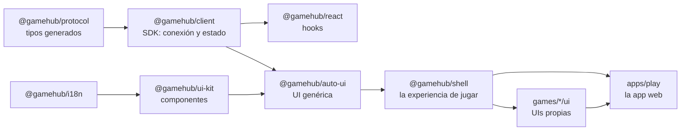

# Cliente web: jugar en el navegador

> Estado: **implementado** (Fase 4, 2026-10-10). Código: [`web/`](../../web) y las UIs propias de
> [`games/*/ui`](../../games). Protocolo: [protocolo](protocolo.md). Pistas de presentación:
> [lenguaje](lenguaje-game.md) §12.

Cualquier juego de GameHub se juega en el navegador, en el ordenador o en el móvil, sin escribir
interfaz: la **UI genérica** lo dibuja a partir de su IR. Un juego puede tener además una **UI
propia**, hecha con la plantilla en menos de una hora, que la app usa en su lugar.

## 1. Cómo se usa

```bash
pnpm install && pnpm build                       # una vez: la app web (en la raíz del repositorio)
cd python && uv run gamehub serve ../games --open    # el servidor de partidas sirve la app
```

- **`gamehub serve`** y **`gamehub host`** sirven la app (`--no-web` para no hacerlo, `--open` abre
  el navegador). El enlace de cada sala (`http://192.168.1.20:7420/r/K7FQ2P`) y su QR abren la
  app: desde el móvil basta con escanearlo. La rueda de Python lleva la app compilada.
- **Inicio**: entrar con un código, crear una sala de cualquier juego del servidor (jugadores,
  opciones del juego, reloj, espectadores, bots), salas abiertas y partidas recientes.
- **Sala**: se entra como jugador o como espectador; la sesión se guarda, así que al recargar se
  vuelve al mismo asiento. En el lobby: código, enlace y QR para invitar, asientos (sentarse,
  levantarse; el anfitrión pone bots, libera o echa), configuración del anfitrión, «Estoy listo»,
  chat y el compromiso del azar verificable. Al terminar, el resultado, el replay y la revancha.
- **Partida**: la UI propia del juego si la tiene (con un botón para cambiar a la genérica) o la
  genérica; abandonar; aviso si se corta la conexión (se reconecta sola) o si la sala se abre en
  otra pestaña.
- **Replays** (`/replay/ID`): la partida estado a estado, desde la perspectiva de cualquier
  asiento, de un espectador o con todo a la vista; reproducir, paso a paso o con el teclado.
- **En este dispositivo** (`/local/JUEGO`): varias personas por turnos en la misma pantalla (con
  bots si se quiere). Si el juego tiene información oculta, la pantalla se tapa entre turnos
  («Turno de Ana: pásale el dispositivo»). Usa el servidor que sirve la app, con una conexión por
  asiento; el motor en el navegador llegará con WASM (F8).
- **Galería del kit** (`/kit`): todos los componentes, para verlos de un vistazo.
- Español e inglés (se recuerda la elección), tema claro u oscuro, y diseño que se adapta al móvil.

## 2. Paquetes



| Paquete | Qué hace |
|---|---|
| `@gamehub/protocol` | Tipos de todos los mensajes, generados desde el JSON Schema por el mismo generador que los de Python (`gamehub protocol types`); códigos de sala |
| `@gamehub/client` | `GameClient`: WebSocket (navegador o Node 22), peticiones con respuesta, reconexión con `resume`, latido, ids únicos, resync; estado inmutable con un reductor puro; acciones legales y progresivas; sesiones en localStorage; API REST |
| `@gamehub/react` | `GameClientProvider`, `useView<Estado>()`, `useLegalActions()`, `useAct()`… sobre `useSyncExternalStore` |
| `@gamehub/i18n` | Textos traducibles de la IR, catálogos es/en comprobados por TypeScript, idioma recordado |
| `@gamehub/ui-kit` | Rejilla, carta, mano en abanico, montón, mazo, dado, ficha, recorrido, grafo, insignia de jugador, marcador, contador, fichas de apuesta, reloj, barra de acciones; todo con variables CSS `--gh-…` (tema claro y oscuro) |
| `@gamehub/auto-ui` | La UI genérica (§3) |
| `@gamehub/shell` | Inicio, crear sala, sala, partida, replays y partidas locales, como librería: la usan la app y el servidor de desarrollo de cada UI propia |
| `apps/play` | La app (Vite) que sirve el servidor; registra sola las UIs de `games/*/ui` |

El workspace de pnpm está en la raíz del repositorio e incluye `web/packages/*`, `web/apps/*` y
`games/*/ui`. Pila: Node 22, TypeScript 7 estricto, React 19, Vite 8, Biome (lint y formato),
Vitest; versiones exactas en el catálogo de `pnpm-workspace.yaml` ([ADR-044](decisiones.md)).

## 3. La UI genérica

Lo dibuja todo a partir de la IR, la vista de cada actualización y las acciones legales:

- **Cada variable de estado según su tipo**: rejilla → tablero; zona o bolsa de un asiento → mano
  (las ajenas, boca abajo con su tamaño); zona compartida → fila (o mazo si nadie la ve); números
  → contador; asiento → el jugador; enumerados → su nombre, símbolo o color; structs con `rank` y
  `suit` (o con la pista `card`) → cartas de baraja. Las variables `per_player` van en el panel de
  cada asiento (con su reloj y, al final, su puesto); las demás, en la mesa. Lo que nadie ve nunca
  (visibilidad `none`) no se dibuja.
- **Cada argumento de una acción según su dominio**: `cells(G)` → pulsar una casilla de la
  rejilla G; `subsets(items(Z), a, b)` → marcar de a a b elementos de la zona Z y confirmar;
  `items(Z)` → pulsar uno; el resto (números, enumerados…) → botones o, si son muchos, una lista.
  Las pistas `ui` (`column(board)`, `pick(hand)`…) lo dicen cuando el dominio no basta.
- **El constructor de acciones** elige los argumentos en el orden en que se declaran, con los
  valores posibles que dicen las acciones legales: enumeradas o, si son demasiadas (más de 500
  por defecto), progresivas con `query_actions`. Los valores posibles se calculan una vez por
  actualización. Para marcar varios con acciones progresivas basta con respetar el tamaño del
  dominio, sin pedir la lista de todos los subconjuntos; el servidor rechaza lo que no valga.
- **Barra de estado** (nodo, «Te toca», de quién es el turno o a quién se espera), **registro de
  eventos** en frases (es/en, con la jugada antes de lo que provoca) y **resultado** con puestos y
  pagos.

Las [pistas `ui { … }`](lenguaje-game.md) del juego ponen nombres traducidos, símbolos, colores,
cartas, dados y fichas, ocultan variables auxiliares y dicen dónde va cada cosa. Los 22 paquetes
del catálogo las tienen ([ADR-047](decisiones.md), [ADR-048](decisiones.md)).

## 4. UIs propias en menos de una hora

Desde la raíz del repositorio:

```bash
cd python && uv run gamehub ui new ../games/mi-juego && cd ..   # crea games/mi-juego/ui
pnpm install                                                     # lo enlaza con los paquetes
cd python && uv run gamehub serve ../games                       # el servidor (otra terminal)
cd games/mi-juego/ui && pnpm dev                                 # la app solo con ese juego
```

La plantilla trae:

- `src/game.ts`: los **tipos del juego** (`gamehub sdk ts`): el estado tal como se ve (lo que
  puede llegar oculto, como `Hidden`), las acciones, las opciones y los nodos. Si cambian las
  reglas, `pnpm types` los regenera y TypeScript señala lo que hay que tocar; un test comprueba
  que los de las UIs del catálogo siguen al día.
- `src/Board.tsx`: un tablero inicial que **ya funciona** (el estado tal cual y un botón por
  acción legal), para ir cambiándolo. Recibe `view`, `actions` (las legales, tipadas), `act`,
  `seat`, `players`, `log`, `clocks`, `params`…
- `src/index.tsx` (`defineGameUi`), estilos, un test con Testing Library y el servidor de
  desarrollo con recarga en caliente.

Pasos típicos: dibujar el estado con el kit (`Grid`, `PlayingCard`, `Hand`, `Die`, `Token`…),
convertir las acciones legales en gestos (pulsar, arrastrar, marcar) y añadir lo que la UI
genérica no sabe (la línea ganadora, animaciones, un resumen). Ejemplos, hechos con la plantilla:

| UI | Qué añade | Tamaño |
|---|---|---|
| [Tres en raya](../../games/tictactoe/ui) | Marcas dibujadas en SVG con animación, línea ganadora, vista previa de tu marca | 177 líneas + 160 de CSS |
| [Conecta 4](../../games/connect-four/ui) | Tablero azul, fichas que caen, columna resaltada con la ficha que caería, línea ganadora | 153 líneas + 153 de CSS |
| [Dudo](../../games/dudo/ui) | Apuesta en el tapete, historia de la ronda, cubiletes ajenos con sus dados tapados, resumen de la última dudada, selector de apuesta con dados | 268 líneas + 183 de CSS |
| [Ajedrez](../../games/chess/ui) (F6) | Tablero girado para las negras, destinos legales al pulsar una pieza, elección de la pieza al coronar, última jugada y rey en jaque resaltados, piezas capturadas y lista de jugadas | 363 líneas + 221 de CSS |
| [Texas Hold'em](../../games/texas-holdem/ui) (F6) | Mesa de tapete con los jugadores alrededor, fichas y apuestas de la ronda, botón, cartas comunes y bote; retirarse, pasar o igualar, y apostar o subir con una barra y atajos (mínimo, medio bote, bote, todo) | 327 líneas + 206 de CSS |
| [Wizard](../../games/wizard/ui) (F6) | Carta de triunfo, la baza en juego y la última (sacada del registro), apuesta, bazas y puntos de cada jugador, un botón por apuesta posible, cartas que no se pueden jugar apagadas, elegir triunfo si sale un mago | 231 líneas + 132 de CSS |
| [Parchís](../../games/parchis/ui) (F6) | Tablero en cruz de 68 casillas en SVG (seguros, salidas, pasillos, casas y meta), fichas que se pueden mover resaltadas y accesibles con el teclado, dado, premio y seises seguidos | 269 líneas + 149 de CSS + 101 de geometría |

La app web registra sola las UIs de `games/*/ui` al compilarse ([ADR-050](decisiones.md)).

## 5. Pruebas

- **SDK contra el servidor de Python de verdad**: dos clientes juegan con una caída y un
  espectador; acciones progresivas.
- **Aceptación de la UI genérica**: cada uno de los 22 juegos del catálogo se juega entero contra
  el servidor solo pulsando controles de la UI, al azar con semilla (el Skat, el Solitario, el
  Hold'em y Wizard con opciones más cortas para que el test no tarde minutos).
- **Navegador contra terminal**: Ana juega en la app y Luis con `gamehub join` en una terminal de
  verdad, hasta el final.
- **Sala con la app**: entrar, sentarse, poner un bot, jugar y ver el resultado; mirar como
  espectador una partida de dos bots.
- Componentes, constructor de acciones, formularios, rutas, UIs propias, generador de tipos (con
  el formato de Biome) y plantilla.

Los tests de integración arrancan `gamehub serve` con uv (`GAMEHUB_SKIP_SERVER_TESTS=1` los
salta). En jsdom, los clientes usan el WebSocket del paquete `ws`: el del navegador simulado
(undici) choca con la clase `Event` de jsdom.

## 6. Pendiente

- Animar los cambios a partir de los eventos (cartas que vuelan de una zona a otra).
- Motor en el navegador (WASM, F8): partidas locales y replays sin servidor, y app instalable.
- Más formas de dibujar en las pistas (recorridos, grafos, dados como argumento).
- Revisión de accesibilidad con lector de pantalla y teclado en las siete UIs propias.
- UIs propias para el Skat y el Solitario (hoy, la genérica).
