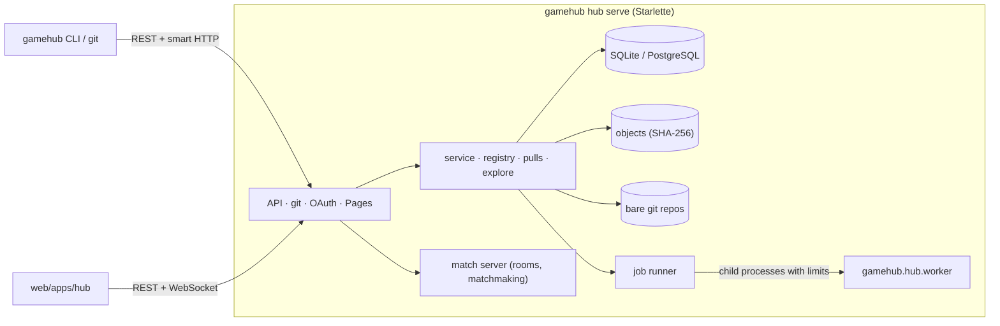

# The Hub — "GitHub for games"

> Status: **implemented** (Phase 10, 2026-10-18): `gamehub hub serve` runs a hub with git
> repositories of games and libraries, accounts and organizations, a version registry with
> automatic semver, forks and proposals reviewed in four layers, sandboxed jobs, hosted rooms with
> matchmaking and human ratings, search by mathematical properties, family trees, Pages and
> moderation; `web/apps/hub` is its website. Decisions: ADR-090 to 097 in
> [decisions](decisions.md). Licensed AGPL-3.0-or-later (ADR-016).

## 1. Idea

Every game is a **git repository** with a `game.toml`. The hub **does not reinvent git**: it hosts
bare repositories and serves them with git's own smart HTTP (`git http-backend`), so `git clone`,
`git push` and branches work as usual. On top it adds everything that understands games: rendered
rules and diagrams, matches, analyses, bots, interfaces, semantic diffs and versions whose number
says what changed.



## 2. Quick start

```bash
gamehub hub serve --data hub-data --admin juanma        # http://127.0.0.1:7430
gamehub login --hub http://127.0.0.1:7430                # user + password → an API token
cd my-game && git init && git add -A && git commit -m "First version"
gamehub publish                                          # creates juanma/my-game, pushes, 0.1.0
gamehub fork juanma/my-game --as my-variant              # (as someone else) fork + clone
# … edit, commit …
gamehub hub pr create --title "Two dice instead of one"  # pushes the branch, opens the proposal
gamehub hub pr show 1 --repo juanma/my-game              # text, semantic diff, balance
gamehub hub pr merge 1 --repo juanma/my-game             # (as the owner)
gamehub publish --repo juanma/my-game                    # 0.2.0: the change decides the number
gamehub hub search "2 players zero-sum perfect information"
```

Everything also works from the website: sign up, create a repository from a template, edit files
in the browser (on a new branch or in your fork), open and review proposals, publish, play.

## 3. Entities

| Entity | Description |
|---|---|
| Account | A person (password and/or OAuth) or an **organization** (members with the `owner` or `member` role) |
| Repository | A **game** or a **library** (reusable modules); bare git under `data/repos/<id>.git` |
| Version (release) | semver + commit + **rules hash** + **interface hash** + the IR (in the object store) + classification; immutable, can be *yanked* |
| Fork | A copy of a repository that remembers its parent: the family tree |
| Proposal (PR) | A branch of a repository of the same family proposed into a branch of another, reviewed in four layers |
| Job | Analysis, balance report, Balance CI or bot arena, in a sandboxed child process |
| Match | A finished match of a hosted room, tied to the rules hash; rated if all seats were distinct people with accounts |
| Page | A static interface (`.tar.gz` with `index.html`) bound to an interface hash |
| Report | Content reported to the moderators |

## 4. A game's page

`Rules` (the generated rulebook and the diagram of any version or branch, the hashes) · `Code`
(tree, files with Nomos highlighting, commits, editing from the browser) · `Versions` (with a dry
run of the next publication) · `Proposals` · `Analysis` (size, branching, length, what can be
computed; analysis, balance and arena jobs) · `Leaderboard` (human Elo, Glicko-2 and TrueSkill per
rules hash, recent matches) · `Interfaces` (Pages) · `Variants` (the family tree, dependencies and
dependents) · `Activity`. And **Play**: create a room (shareable code, bots, options),
**find a match** (matchmaking) or play on this device (the WebAssembly core).

## 5. Versions and automatic semver

Publishing (`gamehub publish`, `POST /repos/{owner}/{name}/releases` or the web) compiles the
package at a commit — with its hub dependencies resolved inside the hub, without network —, stores
its IR, computes the hashes and the static classification, tags the commit `vX.Y.Z` and registers
the version; an `analyze` job then adds the estimated size, branching and length (search
properties).

The **interface** of a game is what UIs and bots depend on: the room options (`params` with their
types), the view (each visible state variable with its type and visibility), the actions (each
signature: parameter names, types and visibility), the events (names and fields) and the types
those mention. Its SHA-256 is the **interface hash** (`gamehub.ir.interface`). Comparing with the
previous version:

| Change | Level | Example |
|---|---|---|
| Something of the interface removed or changed | **major** | an action renamed, a view field hidden, an enum value added to a used type |
| The rules change, or the interface only grows | **minor** | a payoff, a condition or an option's default; a new action or view field |
| Only texts, presentation (`ui`) or heuristics | **patch** | a translated title |

In `0.y.z` everything moves one level down, as in Cargo. Without `--version` the hub picks
`previous.bump(level)`; a version that is too low is refused with the minimum it needs. Agents that
number actions (F11) pin the interface hash itself, not a semver range.

## 6. Dependencies

```toml
[dependencies]
"juanma/tricks" = "^1.2"                                   # a hub dependency: owner/name = requirement
bids = { hub = "juanma/bids", version = "~0.3", registry = "https://hub.example.org" }
local = { path = "modules" }                                # inside the repository
```

Requirements follow Cargo (`^1.2`, `~1.2.3`, `>=0.3, <0.4`, `1.*`, `=1.2.3`). `gamehub fetch` asks
the registry (`registry`, `GAMEHUB_HUB` or the hub of `gamehub login`) for the highest
non-yanked version that matches, downloads its git commit like any git dependency and pins it in
`game.lock` (with `hub` and `version`). On the server, git dependencies and paths outside the
repository are refused: a published version can always be rebuilt from the hub alone.

## 7. Proposals: four layers of review

1. **Text**: the unified git diff from the common base.
2. **Semantics**: the IR diff in Nomos (`gamehub.render.diff`), the interface changes and the
   semver level publishing it would require.
3. **Visual**: the diagram of the proposal with what was added (green), removed (red, dashed) and
   changed (amber) — the Studio's model and SVG.
4. **Behavior (Balance CI)**: a job plays both versions with the same bots and seeds and compares
   seat advantage, draws, length, skill vs. luck, the skill chain, unused rules, dominant actions
   and kingmaking (`gamehub.bots.balance.compare`).

The hub copies the proposed branch into the target repository (`refs/pull/N/head`) and refreshes it
when the fork moves. Merging is a fast-forward when possible and otherwise a merge commit made
without a working tree (`git merge-tree`); conflicts are resolved in the fork. Comments, closing and
merging are on the proposal's page.

## 8. Jobs, quotas and sandboxing

Jobs wait in a queue (`jobs` table) and run in **child processes** (`python -m
gamehub.hub.worker`) with OS limits (CPU time, memory where the OS allows it, no core dumps), an
empty environment, a temporary home and a wall-clock deadline; they receive only the IR and their
options (never the database) and only the core's bots play (no third-party code). Automatic jobs
(each version's analysis, each proposal's Balance CI) belong to the hub; jobs someone asks for
count against their quota.

| Quota (`hub.toml`, `[quotas]`) | Default |
|---|---|
| Repositories per account | 100 |
| Repository size / one push | 50 MB / 20 MB |
| Jobs per day / at once | 50 / 2 |
| Job time / CPU / memory | 600 s / 300 s / 1024 MB |
| A Page | 20 MB |

The API also limits requests per address (30/s with bursts).

## 9. Playing on the hub

The hub embeds the [match server](protocol.md): rooms are created with a version reference
(`juanma/wizard@1.2.0`, or `juanma/wizard` for the latest) and played with the same protocol, web
pages and custom UIs (by game id) as `gamehub serve`. A seat taken by someone signed in is tied to
their account. **Matchmaking** keeps a queue per (version, players): the hub opens a room, seats
everyone with their token and the web takes them in; it pairs by Elo first and widens the window
with the waiting time. Finished matches are stored; those between distinct signed-in people
without bots or takeovers are **rated**: Elo (maximum likelihood), Glicko-2 and TrueSkill per
rules hash, recomputed from all rated matches of those rules. Matches are flagged "humans only"
or "with bots".

## 10. Search and family tree

Every version is classified automatically (players, chance, perfect information, simultaneity,
zero-sum) and its analysis adds the mean branching and length, so the search filters by them,
plus text, tags (`#cards`), kind and owner. A free-text query understands the properties in English
or Spanish: *"2 players zero-sum perfect information branching < 10"*, *"información oculta para 4
jugadores"*. The **family tree** of a repository is its fork network from the original, plus the
hub dependencies of its latest version and the repositories that depend on it.

## 11. Pages

A Page is a static interface (`gamehub ui` builds one) uploaded as a `.tar.gz` and bound to an
interface hash: it works with every version that shares it, and a version's page lists the
compatible ones. Pages are third-party code: they are served under `/pages/owner/name/page/` with
`Content-Security-Policy: sandbox` (an opaque origin without the hub's cookies or storage); a
production hub should serve them from another domain.

## 12. Accounts, security and moderation

- Passwords with scrypt; browser sessions in an `HttpOnly`, `SameSite=Lax` cookie, stored hashed;
  API tokens (`ghb_…`) for the CLI and git, stored hashed and revocable; OAuth 2 with `state`
  (GitHub, Google or any provider with authorize, token and userinfo URLs).
- A request that changes something with the browser's cookie and another site's `Origin` is
  refused (CSRF).
- Pushes cannot create, move or delete release tags (`v1.2.3`) or proposal refs (a `pre-receive`
  hook and `receive.hideRefs`); git runs without the global or system configuration.
- **Terms of use** (`terms.md`, replaceable per hub) must be accepted to sign up; changing their
  version asks every account to accept them again.
- Anyone can **report** a repository, an account or a proposal; moderators (`admins` in
  `hub.toml` or `--admin`) hide repositories and suspend accounts.

## 13. Configuration and deployment

`gamehub hub serve --data DIR [--config hub.toml] [--public-url URL] [--database URL]
[--workers N] [--admin NAME]`. The data directory holds the database (SQLite by default), the
object store, the bare repositories, the dependency cache and the Pages. PostgreSQL needs the
`gamehub[hub-postgres]` extra (`--database postgresql://…`); the tests run against it with
`GAMEHUB_TEST_POSTGRES`. Behind a TLS proxy set `public_url` and `secure_cookies = true`. Where to
host it is [question 14](open-questions.md).

## 14. API

All under `/api/v1`, JSON, errors as `{"error": {"code", "message"}}`.

| Area | Endpoints |
|---|---|
| Hub | `GET hub`, `GET terms`, `GET templates`, `GET session`, `GET explore`, `GET search` |
| Accounts | `POST auth/signup`, `POST auth/login`, `POST auth/logout`, `POST auth/token`, `GET/PATCH me`, `POST me/terms`, `GET/POST me/tokens`, `DELETE me/tokens/{id}`, `GET accounts/{name}`, `POST orgs`, `PUT/DELETE orgs/{org}/members/{name}` |
| Repositories | `POST repos`, `GET/PATCH/DELETE repos/{o}/{n}`, `POST …/forks`, `PUT/DELETE …/star`, `GET …/branches`, `…/commits`, `…/tree`, `…/file`, `…/raw`, `POST …/files`, `GET …/compiled`, `…/events`, `…/family` |
| Versions | `GET/POST …/releases`, `GET …/releases/{v}`, `…/{v}/ir`, `…/{v}/view`, `POST …/{v}/yank`, `GET …/resolve?requirement=` |
| Proposals | `GET/POST …/pulls`, `GET …/pulls/{n}`, `…/{n}/diff`, `POST …/{n}/merge`, `…/{n}/close`, `…/{n}/comments` |
| Jobs | `GET/POST …/jobs`, `GET jobs/{id}` |
| Playing | the match server's (`info`, `rooms`, `games/{ref}`, `matches`, `replays`, `WS /ws`), `POST matchmaking`, `GET/DELETE matchmaking/{id}`, `GET …/ratings`, `GET ratings/{rules_hash}` |
| Pages | `GET/POST …/pages`, `DELETE …/pages/{name}`; served at `/pages/{o}/{n}/{page}/…` |
| Moderation | `POST reports`, `GET admin/reports`, `POST admin/reports/{id}`, `POST admin/repos/{o}/{n}`, `POST admin/accounts/{name}` |

Git: `/{owner}/{name}.git` (smart HTTP). OAuth: `/auth/{provider}/login` and `/callback`.

## 15. Intellectual property (note)

A game's mechanics are usually treated as unprotectable ideas, but **the text of a rulebook, the
art and the trademarks are protected**. The default terms ask authors to write rules in their own
words; a legal review is advisable before opening a hub to the public.

## 16. Not yet

An S3-compatible object store and multi-node rooms (when hosting is decided, question 14); issues
and notifications; organizations' teams and private repositories; publishing bots as entrants of a
hosted arena (bots run as jobs with the core's kinds); tournaments of people.
