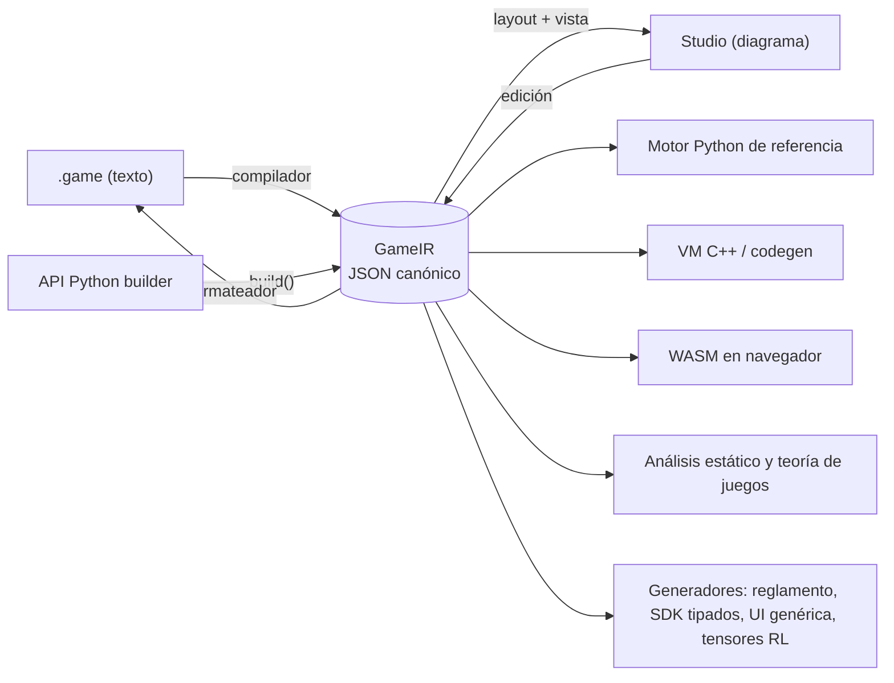

# GameIR — representación intermedia canónica

> Estado: **IR núcleo v0.1 especificada** (Fase 0, 2026-10-09) en [`spec/ir/v0`](../../spec/ir/v0),
> con 4 juegos de validación y un validador (`gamehub ir check`). Desde la Fase 2, el compilador de
> [Nomos](lenguaje-game.md) genera esta IR y el descompilador la vuelve a escribir en Nomos.

## 1. Por qué una IR

La GameIR es **el juego**. Todo lo demás son vistas o consumidores:



Propiedades exigidas: **neutral al lenguaje** (sin nada específico de Python), **serializable**,
**versionada** (`ir_version`), **validable** con JSON Schema y **canónica** (una forma única por juego,
para poder calcular su hash).

## 2. Dos niveles

| Nivel | Quién lo produce | Contenido |
|---|---|---|
| **IR de autor** | Compilador/Studio, tras parsear | En la Fase 2 es el **AST de Nomos** más el modelo del juego (módulos, mods y combinadores sin resolver), con posiciones y comentarios; el round-trip texto ↔ IR lo garantiza el descompilador (ADR-029). El editor visual (F5) trabajará sobre él. |
| **IR resuelta** | `gamehub check` (lowering) | Imports resueltos, tipos anotados, azúcar eliminado (bucles → nodos + contadores, `deal` → `move`s, `table` → `match`). Es lo que consumen los motores. Sobre ella se calcula el hash. |

Conjunto de nodos de la IR resuelta (núcleo mínimo): `decision`, `simultaneous`, `window`,
`chance`, `auto`, `phase` (compuesto, sin azúcar de bucles), `terminal`.

## 3. Estructura

Esquema: [`ir.schema.json`](../../spec/ir/v0/ir.schema.json). Claves de primer nivel:
`ir_version`, `game` (id + versión), `meta`, `players` (min/max), `params`, `constraints`,
`types` (enum/struct), `state`, `functions`, `flow` (`setup`, `start`, `nodes`).

Extracto de [`tictactoe.ir.json`](../../spec/ir/examples/tictactoe.ir.json):

```json
{
  "ir_version": "0.1.0",
  "game": { "id": "tictactoe", "version": "1.0.0" },
  "players": { "min": 2, "max": 2 },
  "types": [{ "kind": "enum", "name": "Mark", "values": ["X", "O"] }],
  "state": [
    { "name": "board", "type": ["grid", 3, 3, ["option", "Mark"]], "init": ["const", null], "visibility": "all" },
    { "name": "turn", "type": "Seat", "init": ["const", 0], "visibility": "all" }
  ],
  "flow": {
    "start": "Move",
    "nodes": [
      { "id": "Move", "kind": "decision", "actor": ["var", "turn"],
        "actions": [{
          "name": "place",
          "params": [{ "name": "c", "type": "Cell", "domain": ["cells", ["var", "board"]] }],
          "requires": ["is_none", ["index", ["var", "board"], ["arg", "c"]]],
          "effects": [["assign", ["index", ["var", "board"], ["arg", "c"]], ["call", "mark", ["var", "turn"]]]]
        }],
        "transitions": [
          { "to": "Win", "when": ["call", "wins", ["call", "mark", ["var", "turn"]]] },
          { "to": "Draw", "when": ["call", "full"] },
          { "to": "Move", "effects": [["assign", ["var", "turn"], ["next_seat", ["var", "turn"]]]] }
        ] },
      { "id": "Win", "kind": "terminal", "payoff": ["win_loss", ["var", "turn"], ["const", 1], ["const", -1]] },
      { "id": "Draw", "kind": "terminal", "payoff": ["fill", ["const", 0]] }
    ]
  }
}
```

**Tipos** ([`type.schema.json`](../../spec/ir/v0/type.schema.json)): primitivos `Bool`, `Int`,
`Real`, `Text`, `Seat`, `Cell`; nombres de enum/struct; constructores `["option", T]`,
`["list", T]`, `["set", T]`, `["map", K, V]`, `["tuple", …]`, `["per_player", T]`,
`["zone", T]` (ordenada), `["bag", T]` (sin orden) y `["grid", ancho, alto, T]`.

**Visibilidad**: `"all"`, `"none"`, `"owner"` o `{"when": predicado}` con `viewer`, `owner` e
`item_face_up` ligados ([ADR-019](decisiones.md)). En zonas, `size_visibility` controla el tamaño.

## 4. Expresiones y efectos

- Codificación tipo **S-expresión en JSON**: `[op, arg₁, …, argₙ]`. Compacta, trivial de evaluar
  en cualquier lenguaje y fácil de transformar (optimizaciones, análisis de flujo de información).
- Familias de operadores: constantes y referencias (`const`, `var`, `arg`, `local`, `enum`),
  aritmética exacta, comparación, lógica, colecciones (`len`, `in`, `filter`, `map`, `sum`, `any`,
  `all`, `count`, `argmax`, `sort_by`), zonas (`top`, `size`, `contents`), tableros (`cells`,
  `neighbors`, `ray`, `lines`), asientos (`next_seat`, `seats`), `let`, `if`, `match`, `call`.
- Efectos: `assign`, `move`, `move_all`, `reveal`, `set_visibility`, `emit`, `reward`, `for`, `if`,
  y los aleatorios `shuffle`, `roll`, `draw_random`, `sample` (solo en `chance`).
- Lista cerrada y versionada en el **catálogo** [`ops.json`](../../spec/ir/v0/ops.json) (aridad,
  tipo de cada argumento, si es aleatoria, documentación). Los esquemas `expr.schema.json` y
  `stmt.schema.json` se **generan** de él ([ADR-020](decisiones.md)). Añadir un operador es un
  cambio de `ir_version` (minor).

## 5. Hashes

| Hash | Sobre qué se calcula | Para qué sirve |
|---|---|---|
| **Hash de reglas** | IR resuelta en JSON canónico (RFC 8785), sin `meta`, `doc`, mensajes de restricciones ni valores por defecto explícitos ([ADR-025](decisiones.md)) | Identifica exactamente las reglas. Bots, replays, análisis y ratings lo referencian. Implementado: `gamehub.ir.hashing.rules_hash`. |
| **Hash de interfaz** | Esquema de vistas + esquema de acciones + eventos | Compatibilidad de UIs y bots; **semver automático**: si cambia de forma incompatible, la versión debe subir de *major*. |

Un cambio cosmético (renombrar un título, mover una caja del diagrama) no cambia el hash de reglas.

## 6. Layout y comentarios

- La posición de las cajas, colores y grupos plegados del diagrama van en un *sidecar*
  `nombre.layout.json` (no afecta al hash ni a las reglas).
- Los comentarios del texto se adjuntan a nodos de la IR de autor (`"doc"`), para que el
  round-trip texto → diagrama → texto no los pierda.

## 7. Versionado de la IR

- `ir_version` sigue semver. Los motores declaran qué rango soportan.
- Migraciones automáticas `vX → vY` incluidas en el compilador (`gamehub migrate`).

## 8. Validación (implementado)

```bash
cd python
uv run gamehub ir check ../spec/ir/examples/*.ir.json   # esquema + buena formación
uv run gamehub ir schemas --check                       # esquemas generados al día
```

1. **JSON Schema** (forma): campos, tipos de nodo, aridad de cada operador.
2. **Buena formación** (`gamehub.ir.wellformed`): nombres declarados y únicos; referencias a
   variables, parámetros, argumentos, locales, funciones (y su aridad), enums, structs y nodos;
   contextos (`actor` solo en acciones/decisiones, `viewer` solo en visibilidad…); azar solo en
   `flow.setup` y nodos `chance`; asignaciones solo sobre el estado; sin recursión; transiciones
   incondicionales al final; `$exit` solo en fases; nodos con salida.

La comprobación de **tipos** la hace el compilador de Nomos (F2) antes de emitir la IR; los análisis
estáticos (`gamehub check`, ADR-034) y la clasificación trabajan sobre la IR, así que valen para
IR escrita a mano. Pendiente: tiempo y plazos (`timeout`, v0.2).
La ejecución de la IR está descrita en el [motor de referencia](motor.md).
