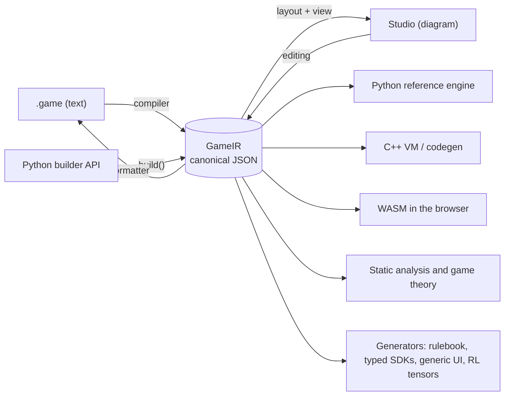

# GameIR — the canonical intermediate representation

> Status: **core IR v0.1 specified** (Phase 0, 2026-10-09) in [`spec/ir/v0`](../../spec/ir/v0),
> with 4 validation games and a validator (`gamehub ir check`). Since Phase 2, the
> [Nomos](language.md) compiler generates this IR and the decompiler writes it back as Nomos.

## 1. Why an IR

The GameIR **is the game**. Everything else is a view or a consumer:



Required properties: **language-neutral** (nothing Python-specific), **serializable**,
**versioned** (`ir_version`), **validatable** with JSON Schema and **canonical** (a single form
per game, so that it can be hashed).

## 2. Two levels

| Level | Who produces it | Contents |
|---|---|---|
| **Authoring IR** | Compiler/Studio, after parsing | Since Phase 2 it is the **Nomos AST** plus the game model (modules, mods and combinators unresolved), with positions and comments; the decompiler guarantees the text ↔ IR round trip (ADR-029). The Studio (F5) edits it: every diagram gesture is an operation on the tree and the text is rewritten only where it changed ([ADR-052](decisions.md)). |
| **Resolved IR** | `gamehub check` (lowering) | Imports resolved, types annotated, sugar removed (loops → nodes + counters, `deal` → `move`s, `table` → `match`). This is what engines consume. The hash is computed on it. |

Node set of the resolved IR (minimal core): `decision`, `simultaneous`, `window`, `chance`,
`auto`, `phase` (compound, without loop sugar), `terminal`.

## 3. Structure

Schema: [`ir.schema.json`](../../spec/ir/v0/ir.schema.json). Top-level keys: `ir_version`, `game`
(id + version), `meta`, `players` (min/max), `params`, `constraints`, `types` (enum/struct),
`state`, `functions`, `flow` (`setup`, `start`, `nodes`) and, optionally, `ui` (presentation
hints for interfaces: `state`, `params`, `types`, `actions`, `nodes`, `seats`; the `ui { … }`
section of Nomos, [language](language.md) §12; added in Phase 4 without changing `ir_version`
because it is optional and does not affect the rules).

Excerpt from [`tictactoe.ir.json`](../../spec/ir/examples/tictactoe.ir.json):

```json
{
  "ir_version": "0.1.0",
  "game": { "id": "tictactoe", "version": "1.0.0" },
  "players": { "min": 2, "max": 2 },
  "types": [{ "kind": "enum", "name": "Mark", "values": ["X", "O"] }],
  "state": [
    { "name": "board", "type": ["grid", 3, 3, ["option", "Mark"]], "init": ["const", null], "visibility": "all" },
    { "name": "turn", "type": "Seat", "init": ["const", 0], "visibility": "all" }
  ],
  "flow": {
    "start": "Move",
    "nodes": [
      { "id": "Move", "kind": "decision", "actor": ["var", "turn"],
        "actions": [{
          "name": "place",
          "params": [{ "name": "c", "type": "Cell", "domain": ["cells", ["var", "board"]] }],
          "requires": ["is_none", ["index", ["var", "board"], ["arg", "c"]]],
          "effects": [["assign", ["index", ["var", "board"], ["arg", "c"]], ["call", "mark", ["var", "turn"]]]]
        }],
        "transitions": [
          { "to": "Win", "when": ["call", "wins", ["call", "mark", ["var", "turn"]]] },
          { "to": "Draw", "when": ["call", "full"] },
          { "to": "Move", "effects": [["assign", ["var", "turn"], ["next_seat", ["var", "turn"]]]] }
        ] },
      { "id": "Win", "kind": "terminal", "payoff": ["win_loss", ["var", "turn"], ["const", 1], ["const", -1]] },
      { "id": "Draw", "kind": "terminal", "payoff": ["fill", ["const", 0]] }
    ]
  }
}
```

**Types** ([`type.schema.json`](../../spec/ir/v0/type.schema.json)): primitives `Bool`, `Int`,
`Real`, `Text`, `Seat`, `Cell`; enum/struct names; constructors `["option", T]`, `["list", T]`,
`["set", T]`, `["map", K, V]`, `["tuple", …]`, `["per_player", T]`, `["zone", T]` (ordered),
`["bag", T]` (unordered) and `["grid", width, height, T]`.

**Declared ranges** (F8): a state variable may carry `"range": [lo, hi]`, two expressions of
parameters and constants: the inclusive range of its numbers (its `Int`, `Seat` or `Real` leaves).
Engines check it on every write (`RuleError` outside) and analyses use it as a bound (global
action ids, ADR-079). Added without changing `ir_version`: it is optional, and an IR without it
means exactly what it meant before.

**Visibility**: `"all"`, `"none"`, `"owner"` or `{"when": predicate}` with `viewer`, `owner` and
`item_face_up` bound ([ADR-019](decisions.md)). In zones, `size_visibility` controls the size.

**Functions**: `{"name", "params": [{name, type}], "returns", "body"}` and, optionally (Phase 6),
`"native": "module.function"`: an engine may replace the function with a plugin that gives the
same results, but `body` is still the reference implementation and is mandatory
([ADR-062](decisions.md), [engine](engine.md#native-plugins)). `native` is part of the rules hash:
marking a function as native does not change what it computes, but it does change what an engine
may do with it.

## 4. Expressions and effects

- **S-expression-in-JSON** encoding: `[op, arg₁, …, argₙ]`. Compact, trivial to evaluate in any
  language and easy to transform (optimizations, information-flow analysis).
- Operator families: constants and references (`const`, `var`, `arg`, `local`, `enum`), exact
  arithmetic, comparison, logic, collections (`len`, `in`, `filter`, `map`, `sum`, `any`, `all`,
  `count`, `argmax`, `sort_by`), zones (`top`, `size`, `contents`), boards (`cells`, `neighbors`,
  `ray`, `lines`), seats (`next_seat`, `seats`), `let`, `if`, `match`, `call`.
- Effects: `assign`, `move`, `move_all`, `reveal`, `set_visibility`, `emit`, `reward`, `for`, `if`,
  and the random ones `shuffle`, `roll`, `draw_random`, `sample` (only in `chance`).
- A closed, versioned list in the **catalog** [`ops.json`](../../spec/ir/v0/ops.json) (arity, type
  of each argument, whether it is random, documentation). The `expr.schema.json` and
  `stmt.schema.json` schemas are **generated** from it ([ADR-020](decisions.md)). Adding an
  operator is an `ir_version` change (minor).

## 5. Hashes

| Hash | What it is computed over | What it is for |
|---|---|---|
| **Rules hash** | The resolved IR as canonical JSON (RFC 8785), without `meta`, `ui`, `doc`, constraint messages or explicit default values ([ADR-025](decisions.md)) | Identifies the rules exactly. Bots, replays, analyses and ratings reference it. Implemented: `gamehub.ir.hashing.rules_hash`. |
| **Interface hash** | View schema + action schema + events | Compatibility of UIs and bots; **automatic semver**: if it changes incompatibly, the *major* version must go up. |

A cosmetic change (renaming a title, moving a box in the diagram) does not change the rules hash.

## 6. Layout and comments

- The position of the boxes, the direction and the collapsed phases of the diagram live in a
  `<game>.layout.json` *sidecar*, by node name (it affects neither the hash nor the rules; format
  in the [Studio](studio.md#2-the-diagram)).
- Comments in the text travel with the elements of the authoring IR (`///` ones as `doc`; the
  rest as each element's *trivia*) and the Studio keeps them when editing from the diagram:
  whatever does not change keeps its text as is.

## 7. IR versioning

- `ir_version` follows semver. Engines declare which range they support.
- Automatic `vX → vY` migrations included in the compiler (`gamehub migrate`).

## 8. Validation (implemented)

```bash
cd python
uv run gamehub ir check ../spec/ir/examples/*.ir.json   # schema + well-formedness
uv run gamehub ir schemas --check                       # generated schemas up to date
```

1. **JSON Schema** (shape): fields, node kinds, arity of each operator.
2. **Well-formedness** (`gamehub.ir.wellformed`): declared, unique names; references to
   variables, parameters, arguments, locals, functions (and their arity), enums, structs and
   nodes; contexts (`actor` only in actions/decisions, `viewer` only in visibility…); chance only
   in `flow.setup` and `chance` nodes; assignments only to the state; no recursion; unconditional
   transitions last; `$exit` only in phases; nodes with an exit.

**Type** checking is done by the Nomos compiler (F2) before emitting the IR; the static analyses
(`gamehub check`, ADR-034) and the classification work on the IR, so they also apply to
hand-written IR. Pending: time and deadlines (`timeout`, v0.2). The execution of the IR is
described in the [reference engine](engine.md).
