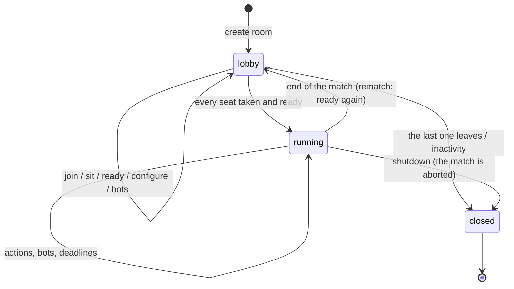

# Match protocol ("the game as an API")

> Status: **v1 implemented** (Phase 3, 2026-10-10). Schema: [`spec/protocol/v1/protocol.schema.json`](../../spec/protocol/v1/protocol.schema.json).
> Server: [`python/src/gamehub/server`](../../python/src/gamehub/server).

## 1. Principles

- **Authoritative server:** the server holds the real state; each client receives **only its
  redacted view** (or the spectator's). Cheating by reading the client's memory is impossible.
- **Interface-agnostic:** the terminal, the web, Godot, Unity or a bot speak exactly the same
  protocol. A bot *is* a client.
- **Transport:** WebSocket + JSON (one connection per client, at `/ws`) and a small REST API to
  create and query rooms. Server: Starlette on uvicorn ([ADR-036](decisions.md)).
- **Typed:** every message has a JSON Schema; the Python types (`TypedDict`) and the TypeScript
  ones (`@gamehub/protocol`) are generated from the schema (`gamehub protocol types --write`).
- **Versioned:** `v: 1` in every message; the game is identified by its *rules hash*.
- **Pure core:** the room logic opens no connections and does not read the time; it is tested
  entirely with a simulated clock ([ADR-037](decisions.md)).

## 2. Concepts

| Concept | Definition |
|---|---|
| **Room** | An instance of a game with its options and settings. It has a 6-character Crockford base32 **code** (`K7F-Q2P`; when typing it, lowercase, dashes and spaces are accepted, and O/I/L read as 0/1/1). It chains matches (rematches). |
| **Seat** | A position in the rules (0..n-1). Kinds: `open` (free), `reserved` (free, kept for a name), `human`, `bot` (a server bot or a client that declares itself a bot). |
| **Participant** | Whoever is in the room: a player (seated) or a spectator. They have a **session token** to reconnect; the server only stores its SHA-256. |
| **Host** | The participant who administers the room: configures it, opens/reserves seats, adds bots, kicks someone out. If they leave, the role passes to another connected person; if nobody is left, the room closes. |
| **Match** | A concrete run: seed, steps and replay. It has an id and a number within the room. |



## 3. REST API (`/api/v1`)

| Method | Path | Description |
|---|---|---|
| `GET` | `/api/v1/info` | Name, version, protocol, whether uploading games is allowed, catalog and number of rooms (`ServerInfo`) |
| `GET` | `/api/v1/rooms` | Open public rooms (`RoomList`) |
| `POST` | `/api/v1/rooms` | Create a room: `{game}` (from the catalog) or `{ir}` (if the server allows it), `players`, `params`, `settings`, `name` → `{code, token, url, room}` (the token is the host's session) |
| `GET` | `/api/v1/rooms/{code}` | Public state of the room (`Room`) |
| `GET` | `/api/v1/rooms/{code}/ir` | IR of the room's game (for interfaces and bots) |
| `GET` | `/api/v1/games/{id}` | IR of a catalog game |
| `GET` | `/api/v1/matches` | Latest finished matches (summary) |
| `GET` | `/api/v1/replays/{id}` | Replay of a **finished** match (reveals the server seed) |
| `GET` | `/api/v1/replays/{id}/frames?seat=all\|public\|N` | The match state by state (view and events) as a seat, a spectator or someone seeing everything saw it, with the IR (to watch replays in an interface) |
| `GET` | `/api/v1/rooms/{code}/qr.svg` | The QR code of the room's link, as SVG |
| `GET` | `/r/{code}` | The web app in that room (or a minimal page if it is not built); with `Accept: application/json`, the `Room` |

Errors: `{"error": {"code", "message"}}` with the matching HTTP status (400, 403, 404, 413, 503).

## 4. WebSocket messages

Envelopes: client `{"v": 1, "type", "id"?, "data"}` · server `{"v": 1, "type", "re"?, "data"}`.
The client chooses `id`; the server echoes it in `re` in direct replies (`joined`, `welcome`,
`rejected`, `actions`, `pong`, `error`) and discards an `act` with an `id` already seen in the
session. That is why it must be unique across the whole session, also if another process resumes
it with the same token: the Python SDK uses a random prefix per client (`3f9a1c2e-17`).

**Client → server**

| Type | Data | Notes |
|---|---|---|
| `hello` | `{client: {name, kind: human\|bot, version?}, token?, resume?: {match, seq}, legal_limit?}` | First message (10 s deadline). With `token`, it resumes the session |
| `join` | `{room, role: player\|spectator, name, seat?}` | Join a room; a player goes to the requested seat or to the first free one |
| `sit` / `stand` | `{seat?}` / `{}` | Sit down or change seats / stand up (lobby) |
| `ready` | `{ready, seed?}` | Ready to start; `seed` = your own seed for chance (§10) |
| `act` | `{seq, action: {name, args}}` | `seq` = last update seen (§5) |
| `query_actions` | `{seq, name?, args?}` | Progressive action building (§6) |
| `resign` | `{}` | Resign the match (§9) |
| `leave` | `{}` | Leave the room (during a match, it resigns) |
| `chat` | `{text}` | Up to 500 characters |
| `ping` | `{t?}` | → `pong {t?, server_time}` |
| `resync` | `{}` | Ask for the room and the state again |
| `configure` | `{players?, params?, settings?}` | Host, in the lobby |
| `set_seat` | `{seat, kind: open\|reserved\|bot, name?, bot?: random\|first}` | Host; during a match only `bot` (it replaces whoever held the seat) |
| `kick` | `{participant}` | Host |

**Server → client**

| Type | Data |
|---|---|
| `welcome` | `{server: {name, version}, session?}` (with `session` when resumed with a token) |
| `joined` | `{token, session: {room, participant, name, role, seat, host}}` |
| `room` | Public state: game, options, settings, status, seats, spectators, chance commitment, the current match and the result of the last one |
| `match_start` | `{match: {id, number}, seat, players, params, seats, fairness, clock}` |
| `update` | `{seq, view, events[], legal?, clocks?}` |
| `actions` | `{seq, name?, args?, options[]}` |
| `rejected` | `{seq, reason: illegal_action\|stale_seq\|not_your_turn\|not_running, detail}` |
| `match_end` | `{match, reason, payoffs, ranking, forfeited, view (omniscient), fairness (revealed), replay}` |
| `chat`, `pong`, `error` | `{sender, text}` · `{t?, server_time}` · `{code, message}` |

**Example** — `update` for seat 1 in Kuhn poker after seat 0 bets (of the opponent's hand only
the size is visible, [ADR-019](decisions.md)):

```json
{ "v": 1, "type": "update", "data": {
    "seq": 1,
    "view": { "node": "Act", "status": "decision", "active": [1],
              "state": { "deck": { "size": 1, "items": [{ "$hidden": true }] },
                         "hand": [ { "size": 1, "items": [] }, { "size": 1, "items": ["K"] } ],
                         "put": [2, 1], "moves": ["Bet"] } },
    "events": [ { "type": "action", "seat": 0, "name": "bet", "args": {} },
                { "type": "node", "node": "Act" } ],
    "legal": { "kind": "enumerated",
               "actions": [ { "name": "call", "args": {} }, { "name": "fold", "args": {} } ] }
} }
```

## 5. Updates, `seq` and turns

- **One update per input**: each action (from a client, a bot or an expired deadline) produces an
  update with the action and all the chance that follows it until the next decision or the end.
  `seq` counts from 0 (the setup) without gaps: a client that receives `seq` 7 after 5 knows it is
  missing one and can ask for `resync`.
- Each recipient gets the **final view** and the **events** of those steps as they see them (the
  engine's per-seat projection), the **legal actions** if it is their turn, and the **clocks**.
- **Current turn**: a seat's turn starts at the first update in which it can act and lasts while
  it still can, without having acted and without reaching any node. An `act` whose `seq` is older
  than the start of the turn is rejected (`stale_seq`): it was decided on a state that is no longer
  the one of that turn. In a simultaneous node or a window, someone else answering does **not**
  change your turn, so there are no spurious rejections ([ADR-038](decisions.md)).
- In `race` windows, the first message the server processes wins (its order of arrival).

## 6. Legal actions

- **Enumerated** (`{"kind": "enumerated", "actions": […]}`) if there are at most `legal_limit` of
  them (the one in `hello`; 256 by default, up to 20,000).
- **Progressive** (`{"kind": "progressive", "names": […]}`) if there are more: the client builds
  the action with `query_actions`: without `name`, the names; with `name` and the first
  arguments, the possible values of the next one (Bullshit: picking cards without enumerating
  4,000 subsets).

## 7. Reconnection and idempotence

- `hello {token}` resumes the session: the server sends `welcome` (with the session), the room
  and, if there is a match, `match_start` and a full update (without events). With
  `resume: {match, seq}` it only sends the later updates, with their events, as if the client had
  never left; if none is missing, it resends the last one without events (same `seq`), to refresh
  clocks and turn. A client treats an update with an already seen `seq` as a refresh.
- If the session is opened from another connection, the old one receives `error replaced` and is
  closed.
- While someone is disconnected the match goes on; if it is their turn, their clock runs (if
  there is one).

## 8. Spectators

- They see the **public view** (what someone who holds no seat sees, [engine](engine.md) §7) or,
  if the room is configured so (`spectator_view: omniscient`), **everything**, as in a poker
  broadcast.
- With `spectator_delay`, everything sent to them goes out that many seconds later. Someone who
  arrives midway receives a summary (room, match start and last update) as it was
  `spectator_delay` seconds ago, and then the rest, delayed.
- A room may refuse spectators (`spectators: false`).

## 9. Time, forfeits and result

- **Clocks** (`clock`): `none`; `move` (a fixed deadline per turn); `match` (a chess clock: total
  time per seat that runs during its turn, plus an increment after moving). They travel in every
  `update` (`clocks`: milliseconds left per seat and who has the clock running).
- **When a deadline expires** (`on_timeout`): `random` (a random legal move, from stream 2 of the
  match's PCG32), `pass` (pass if possible; otherwise random), `bot` (a bot plays for the seat for
  the rest of the match) or `forfeit` (the seat forfeits). A game's own `on_timeout` will come with
  IR v0.2 if a game needs one (chess did not: losing on time is `forfeit`).
- **Forfeit** (`resign`, `leave` during a match, or `forfeit`): the seat ends up **last** and a bot
  plays for it until the end, so the others can finish; if only one seat is left without
  forfeiting, the match ends (`reason: forfeit`, no payoffs).
- **Result** (`match_end`): `reason` (`terminal`, `forfeit` or `aborted`), the engine's payoffs,
  the **place** of each seat (1 = first; from the terminal's `rank` or from the payoffs; those who
  forfeited, last), the final omniscient view, the revealed chance and the replay id.
- **Rematch:** at the end the room goes back to the lobby with the same seats; when everyone is
  ready again the next match starts, with a new chance commitment.

## 10. Provably fair chance

Scheme `gamehub-fair/1` ([engine](engine.md) §9, [ADR-040](decisions.md)):

1. In the lobby, the server publishes `commitment = SHA-256("gamehub-fair/1:commit:" + server_seed)`
   (it travels in every `room` message).
2. Each player can contribute a seed in `ready {seed}`; `match_start` shows them all.
3. Match seed = SHA-256 of the canonical JSON `{scheme, server_seed, client_seeds}` (53 bits).
   Chance is PCG32(seed, stream 1), chance point by chance point.
4. `match_end` reveals `server_seed` and the seed; `gamehub replay` checks the commitment, the seed
   and that every draw in the replay is the one that comes out of it.

For matches without a trusted referee (pure P2P) there is the *mental poker* family of
protocols; it remains future work.

## 11. Persistence

Finished matches are stored with their full replay: in memory or in **SQLite**
(`gamehub serve --db`). With SQLite each step is stored as soon as it is played: if the server
crashes in the middle of a match, at startup that match is closed as aborted (`aborted`) with its
replay up to the last step, verifiable like the rest.

## 12. Limits and security

- Messages of up to 64 KiB, validated against the schema; 20 messages/s per connection with bursts
  of 60 (`error rate_limited`; if it persists, the connection is closed).
- Up to 1,000 rooms and 5,000 connections per server (beyond that: `503` when creating rooms and
  close code `1013` "try again later" for the connection); 32 spectators per room; REST requests of
  up to 2 MiB (`413`); names of up to 32 characters and chat of up to 500, without control
  characters.
- A slow connection has its own queue: if it fills up, it is disconnected (it can reconnect).
- Rooms with nobody connected are closed (30 min in the lobby, 2 h during a match).
- Uploading games (`POST /api/v1/rooms` with `ir`) is disabled unless `--allow-upload`: rules are
  data and the engine limits the steps, but a game can be expensive to run.
- If the rules fail in the middle of a match (`RuleError`), the match is aborted and everyone is
  notified.

### Performance (load test, Apple Silicon, a single server process)

`gamehub loadtest` creates many rooms at once and fills them with random bots that play over
WebSocket as soon as it is their turn (the worst case: nobody thinks), measuring the latency of
each move. With the server in another process (`gamehub serve`) and **100 simultaneous rooms**:

| Game | Connections | Matches | Time | Moves/s | Latency p50 / p95 | Failures |
|---|---:|---:|---:|---:|---:|---:|
| Nim (2 players, 3 matches per room) | 200 | 300 | 1.6 s | ≈ 1,300 | 51 / 64 ms | 0 |
| Dudo (4 players) | 400 | 100 | 5.2 s | ≈ 850 | 95 / 112 ms | 0 |
| Dudo (4 players, 3 matches per room) | 400 | 300 | 14.9 s | ≈ 890 | 99 / 125 ms | 0 |

The latency is that of a deliberately saturated server: with people, who take seconds to move,
each room is idle almost all the time. The cost of each move is dominated by the reference engine
(views and legal actions) and by JSON; the C++ core (F8) will reduce it. Bullshit, with thousands
of legal actions per turn, is the expensive case (a match of 3 bots over the network, ≈ 5 s).

## 13. Connection modes

| Mode | How |
|---|---|
| **Local / hot-seat** | `gamehub play` (terminal) or, in the web app, "On this device": a room on the server that serves the app, with one connection per seat in the same tab, covering the screen between turns when there is hidden information ([ADR-049](decisions.md)). Without a server, once the WASM engine arrives (F8). |
| **LAN** | `gamehub host game.game` opens a server (port 7420) with a room, shows the code, the link (`http://192.168.1.20:7420/r/K7FQ2P`) and its **QR code**, announces it over **mDNS** (`_gamehub._tcp`) and lets you play from the same terminal. On another computer: `gamehub join K7F-Q2P` (it looks for it on this computer and on the LAN) or `gamehub join <link>`. `gamehub rooms` lists the rooms on the LAN. |
| **Online** | `gamehub serve games/` on a reachable machine (the room is created with `POST /api/v1/rooms`); a *relay* for NAT later on. |
| **Bots** | `gamehub bot run agent.py --room K7FQ2P`, or a server bot in a seat (`/bot N` in the terminal, `set_seat` in the protocol). |

The terminal client stores the token of each room in `~/.local/share/gamehub/sessions.json`: if
the terminal is closed in the middle of a match, `gamehub join` with the same code goes back to
the same seat. Commands inside the room: `/listo` (ready), `/chat`, `/sentar` (sit), `/levantar`
(stand), `/estado` (state), `/sala` (room), `/rendirse` (resign), `/salir` (leave) and, for the
host, `/bot`, `/abrir` (open), `/reservar` (reserve), `/echar` (kick), `/jugadores` (players),
`/opcion` (option); `/ayuda` (help) explains them. Moves are picked by number or by filtering with
words; if there are too many, step by step (action, then each parameter).

## 14. SDKs and generated types

- Client SDKs: **Python** (Phase 3) and **TypeScript** (`@gamehub/client`, Phase 4, with React
  hooks in `@gamehub/react`); Godot (GDScript) and C# (Unity) later.
- The message types of both SDKs come from the same schema with `gamehub protocol types`.
- `gamehub sdk ts <game>` generates a **game's types** (state as seen, actions, options, nodes): a
  custom UI gets autocompletion and compile errors if the rules change. See the
  [web client](web-client.md).
