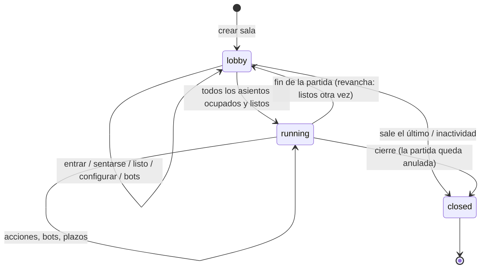

# Protocolo de partidas ("el juego como API")

> Estado: **implementado v1** (Fase 3, 2026-10-10). Esquema: [`spec/protocol/v1/protocol.schema.json`](../../spec/protocol/v1/protocol.schema.json).
> Servidor: [`python/src/gamehub/server`](../../python/src/gamehub/server).

## 1. Principios

- **Servidor autoritativo:** el servidor tiene el estado real; cada cliente recibe **solo su vista
  redactada** (o la de espectador). Imposible hacer trampas leyendo la memoria del cliente.
- **Agnóstico de la interfaz:** la terminal, la web, Godot, Unity o un bot hablan exactamente el
  mismo protocolo. Un bot *es* un cliente.
- **Transporte:** WebSocket + JSON (una conexión por cliente, en `/ws`) y una API REST pequeña
  para crear y consultar salas. Servidor: Starlette sobre uvicorn ([ADR-036](decisiones.md)).
- **Tipado:** todos los mensajes tienen JSON Schema; los tipos de Python (`TypedDict`) se generan
  (`gamehub protocol types --write`) y los de TypeScript se generarán en la Fase 4.
- **Versionado:** `v: 1` en cada mensaje; el juego se identifica por su *hash de reglas*.
- **Núcleo puro:** la lógica de salas no abre conexiones ni lee la hora; se prueba entera con un
  reloj simulado ([ADR-037](decisiones.md)).

## 2. Conceptos

| Concepto | Definición |
|---|---|
| **Sala** (room) | Instancia de un juego con sus opciones y configuración. Tiene un **código** de 6 caracteres de Crockford base32 (`K7F-Q2P`; al escribirlo valen minúsculas, guiones y espacios, y O/I/L se leen 0/1/1). Encadena partidas (revanchas). |
| **Asiento** (seat) | Posición en las reglas (0..n-1). Tipos: `open` (libre), `reserved` (libre, guardado para un nombre), `human`, `bot` (un bot del servidor o un cliente que se declara bot). |
| **Participante** | Quien está en la sala: jugador (sentado) o espectador. Tiene un **token de sesión** para reconectarse; el servidor solo guarda su SHA-256. |
| **Anfitrión** (host) | El participante que administra la sala: configura, abre/reserva asientos, pone bots, echa a alguien. Si se va, el puesto pasa a otra persona conectada; si no queda nadie, la sala se cierra. |
| **Partida** (match) | Ejecución concreta: semilla, pasos y replay. Tiene un id y un número dentro de la sala. |



## 3. API REST (`/api/v1`)

| Método | Ruta | Descripción |
|---|---|---|
| `GET` | `/api/v1/info` | Nombre, versión, protocolo, si admite subir juegos, catálogo y nº de salas (`ServerInfo`) |
| `GET` | `/api/v1/rooms` | Salas públicas abiertas (`RoomList`) |
| `POST` | `/api/v1/rooms` | Crear sala: `{game}` (del catálogo) o `{ir}` (si el servidor lo admite), `players`, `params`, `settings`, `name` → `{code, token, url, room}` (el token es la sesión del anfitrión) |
| `GET` | `/api/v1/rooms/{code}` | Estado público de la sala (`Room`) |
| `GET` | `/api/v1/rooms/{code}/ir` | IR del juego de la sala (para interfaces y bots) |
| `GET` | `/api/v1/games/{id}` | IR de un juego del catálogo |
| `GET` | `/api/v1/matches` | Últimas partidas terminadas (resumen) |
| `GET` | `/api/v1/replays/{id}` | Replay de una partida **terminada** (revela la semilla del servidor) |
| `GET` | `/r/{code}` | Página de la sala (enlace y QR de la LAN); con `Accept: application/json`, el `Room` |

Errores: `{"error": {"code", "message"}}` con el estado HTTP correspondiente (400, 403, 404,
413, 503).

## 4. Mensajes WebSocket

Sobres: cliente `{"v": 1, "type", "id"?, "data"}` · servidor `{"v": 1, "type", "re"?, "data"}`.
`id` lo elige el cliente; el servidor lo devuelve en `re` en las respuestas directas (`joined`,
`welcome`, `rejected`, `actions`, `pong`, `error`) y descarta un `act` con un `id` ya visto en la
sesión. Por eso tiene que ser único en toda la sesión, también si otro proceso la retoma con el
mismo token: el SDK de Python usa un prefijo aleatorio por cliente (`3f9a1c2e-17`).

**Cliente → servidor**

| Tipo | Datos | Notas |
|---|---|---|
| `hello` | `{client: {name, kind: human\|bot, version?}, token?, resume?: {match, seq}, legal_limit?}` | Primer mensaje (10 s de plazo). Con `token`, retoma la sesión |
| `join` | `{room, role: player\|spectator, name, seat?}` | Entrar en una sala; un jugador va al asiento pedido o al primero libre |
| `sit` / `stand` | `{seat?}` / `{}` | Sentarse o cambiar de asiento / levantarse (lobby) |
| `ready` | `{ready, seed?}` | Listo para empezar; `seed` = semilla propia para el azar (§10) |
| `act` | `{seq, action: {name, args}}` | `seq` = última actualización vista (§5) |
| `query_actions` | `{seq, name?, args?}` | Construcción progresiva de acciones (§6) |
| `resign` | `{}` | Abandonar la partida (§9) |
| `leave` | `{}` | Salir de la sala (en partida, abandona) |
| `chat` | `{text}` | Hasta 500 caracteres |
| `ping` | `{t?}` | → `pong {t?, server_time}` |
| `resync` | `{}` | Pedir de nuevo la sala y el estado |
| `configure` | `{players?, params?, settings?}` | Anfitrión, en el lobby |
| `set_seat` | `{seat, kind: open\|reserved\|bot, name?, bot?: random\|first}` | Anfitrión; en partida solo `bot` (sustituye a quien ocupaba el asiento) |
| `kick` | `{participant}` | Anfitrión |

**Servidor → cliente**

| Tipo | Datos |
|---|---|
| `welcome` | `{server: {name, version}, session?}` (con `session` si se retomó con token) |
| `joined` | `{token, session: {room, participant, name, role, seat, host}}` |
| `room` | Estado público: juego, opciones, configuración, estado, asientos, espectadores, compromiso del azar, partida en curso y resultado de la última |
| `match_start` | `{match: {id, number}, seat, players, params, seats, fairness, clock}` |
| `update` | `{seq, view, events[], legal?, clocks?}` |
| `actions` | `{seq, name?, args?, options[]}` |
| `rejected` | `{seq, reason: illegal_action\|stale_seq\|not_your_turn\|not_running, detail}` |
| `match_end` | `{match, reason, payoffs, ranking, forfeited, view (omnisciente), fairness (revelado), replay}` |
| `chat`, `pong`, `error` | `{sender, text}` · `{t?, server_time}` · `{code, message}` |

**Ejemplo** — `update` para el asiento 1 en Póker de Kuhn tras la apuesta del asiento 0 (de la
mano rival solo se ve el tamaño, [ADR-019](decisiones.md)):

```json
{ "v": 1, "type": "update", "data": {
    "seq": 1,
    "view": { "node": "Act", "status": "decision", "active": [1],
              "state": { "deck": { "size": 1, "items": [{ "$hidden": true }] },
                         "hand": [ { "size": 1, "items": [] }, { "size": 1, "items": ["K"] } ],
                         "put": [2, 1], "moves": ["Bet"] } },
    "events": [ { "type": "action", "seat": 0, "name": "bet", "args": {} },
                { "type": "node", "node": "Act" } ],
    "legal": { "kind": "enumerated",
               "actions": [ { "name": "call", "args": {} }, { "name": "fold", "args": {} } ] }
} }
```

## 5. Actualizaciones, `seq` y turnos

- **Una actualización por entrada**: cada acción (de un cliente, de un bot o por plazo vencido)
  produce una actualización con la acción y todo el azar que la sigue hasta la siguiente decisión
  o el final. `seq` cuenta desde 0 (la preparación) sin huecos: un cliente que recibe `seq` 7
  tras la 5 sabe que le falta una y puede pedir `resync`.
- Cada destinatario recibe la **vista final** y los **eventos** de esos pasos tal como él los ve
  (proyección por asiento del motor), las **acciones legales** si le toca y los **relojes**.
- **Turno vigente**: el turno de un asiento empieza en la primera actualización en que puede actuar
  y dura mientras siga pudiendo, sin haber actuado y sin que se llegue a ningún nodo. Un `act` con
  `seq` anterior al comienzo del turno se rechaza (`stale_seq`): se decidió con un estado que ya no
  es el de ese turno. En un nodo simultáneo o una ventana, que otro responda **no** cambia tu
  turno, así que no hay rechazos espurios ([ADR-038](decisiones.md)).
- En las ventanas `race` gana el primer mensaje que procesa el servidor (su orden de llegada).

## 6. Acciones legales

- **Enumeradas** (`{"kind": "enumerated", "actions": […]}`) si hay como mucho `legal_limit` (el
  del `hello`; 256 por defecto, hasta 20 000).
- **Progresivas** (`{"kind": "progressive", "names": […]}`) si hay más: el cliente construye la
  acción con `query_actions`: sin `name`, los nombres; con `name` y los primeros argumentos, los
  valores posibles del siguiente (Mentiroso: elegir cartas sin enumerar 4 000 subconjuntos).

## 7. Reconexión e idempotencia

- `hello {token}` retoma la sesión: el servidor manda `welcome` (con la sesión), la sala y, si hay
  partida, `match_start` y una actualización completa (sin eventos). Con `resume: {match, seq}`
  manda solo las actualizaciones posteriores, con sus eventos, como si no se hubiera ido; si no
  falta ninguna, reenvía la última sin eventos (mismo `seq`), para refrescar relojes y turno.
  Un cliente trata una actualización con un `seq` ya visto como un refresco.
- Si la sesión se abre desde otra conexión, la antigua recibe `error replaced` y se cierra.
- Mientras alguien está desconectado la partida sigue; si le toca, cuenta su reloj (si hay).

## 8. Espectadores

- Ven la **vista pública** (lo que ve quien no ocupa ningún asiento, [motor](motor.md) §7) o, si la
  sala lo configura (`spectator_view: omniscient`), **todo**, como en una retransmisión de póquer.
- Con `spectator_delay` todo lo que se les envía sale ese número de segundos después. Quien llega a
  mitad recibe un resumen (sala, inicio de la partida y última actualización) tal como estaba hace
  `spectator_delay` segundos y después lo demás, en diferido.
- La sala puede no admitir espectadores (`spectators: false`).

## 9. Tiempo, abandonos y resultado

- **Relojes** (`clock`): `none`; `move` (un plazo fijo por turno); `match` (reloj de ajedrez:
  tiempo total por asiento que corre en su turno, más un incremento tras jugar). Viajan en cada
  `update` (`clocks`: milisegundos restantes por asiento y quién tiene el reloj en marcha).
- **Al vencer un plazo** (`on_timeout`): `random` (una jugada legal al azar, del flujo 2 de PCG32
  de la partida), `pass` (pasar si se puede; si no, al azar), `bot` (un bot juega por el asiento el
  resto de la partida) o `forfeit` (abandona). El `on_timeout` propio de cada juego llegará con la
  IR v0.2.
- **Abandono** (`resign`, `leave` en partida o `forfeit`): el asiento queda **el último** y un bot
  juega por él hasta el final, para que los demás terminen; si solo queda un asiento sin abandonar,
  la partida termina (`reason: forfeit`, sin pagos).
- **Resultado** (`match_end`): `reason` (`terminal`, `forfeit` o `aborted`), pagos del motor,
  **puesto** de cada asiento (1 = primero; del `rank` del terminal o de los pagos; quienes
  abandonaron, al final), la vista omnisciente final, el azar revelado y el id del replay.
- **Revancha:** al terminar la sala vuelve al lobby con los mismos asientos; cuando todos se
  declaran listos de nuevo empieza la partida siguiente, con un compromiso de azar nuevo.

## 10. Azar verificable ("provably fair")

Esquema `gamehub-fair/1` ([motor](motor.md) §9, [ADR-040](decisiones.md)):

1. En el lobby, el servidor publica `commitment = SHA-256("gamehub-fair/1:commit:" + server_seed)`
   (va en cada mensaje `room`).
2. Cada jugador puede aportar su semilla en `ready {seed}`; `match_start` las muestra todas.
3. Semilla de la partida = SHA-256 del JSON canónico `{scheme, server_seed, client_seeds}`
   (53 bits). El azar es PCG32(semilla, flujo 1), punto de azar a punto de azar.
4. `match_end` revela `server_seed` y la semilla; `gamehub replay` comprueba el compromiso, la
   semilla y que cada sorteo del replay sea el que sale de ella.

Para partidas sin árbitro de confianza (P2P puro) existe la familia de protocolos *mental poker*;
queda como trabajo futuro.

## 11. Persistencia

Las partidas terminadas se guardan con su replay completo: en memoria o en **SQLite**
(`gamehub serve --db`). Con SQLite cada paso se guarda en cuanto se juega: si el servidor se cae a
mitad de partida, al arrancar esa partida se cierra como anulada (`aborted`) con su replay hasta
el último paso, verificable igual que las demás.

## 12. Límites y seguridad

- Mensajes de hasta 64 KiB, validados contra el esquema; 20 mensajes/s por conexión con ráfagas
  de 60 (`error rate_limited`; si se insiste, se cierra la conexión).
- Hasta 1 000 salas y 5 000 conexiones por servidor (más allá: `503` al crear salas y cierre
  `1013` «vuelve más tarde» de la conexión); 32 espectadores por sala; peticiones REST de hasta
  2 MiB (`413`); nombres de hasta 32 caracteres y chat de hasta 500, sin caracteres de control.
- Una conexión lenta tiene su propia cola: si se llena, se la desconecta (puede reconectar).
- Las salas sin nadie conectado se cierran (30 min en el lobby, 2 h en partida).
- Subir juegos (`POST /api/v1/rooms` con `ir`) está desactivado salvo `--allow-upload`: las reglas
  son datos y el motor limita los pasos, pero un juego puede ser caro de ejecutar.
- Si las reglas fallan en mitad de una partida (`RuleError`), la partida se anula y se avisa.

### Rendimiento (prueba de carga, Apple Silicon, un solo proceso de servidor)

`gamehub loadtest` crea muchas salas a la vez y las llena de bots aleatorios que juegan por
WebSocket en cuanto les toca (el peor caso: nadie piensa), midiendo la latencia de cada jugada.
Con el servidor en otro proceso (`gamehub serve`) y **100 salas simultáneas**:

| Juego | Conexiones | Partidas | Tiempo | Jugadas/s | Latencia p50 / p95 | Fallos |
|---|---:|---:|---:|---:|---:|---:|
| Nim (2 jugadores, 3 partidas por sala) | 200 | 300 | 1,6 s | ≈ 1 300 | 51 / 64 ms | 0 |
| Dudo (4 jugadores) | 400 | 100 | 5,2 s | ≈ 850 | 95 / 112 ms | 0 |
| Dudo (4 jugadores, 3 partidas por sala) | 400 | 300 | 14,9 s | ≈ 890 | 99 / 125 ms | 0 |

La latencia es la de un servidor saturado a propósito: con personas, que tardan segundos en
jugar, cada sala está casi siempre parada. El coste de cada jugada lo dominan el motor de
referencia (vistas y acciones legales) y el JSON; el core C++ (F8) lo reducirá. Mentiroso, con
miles de acciones legales por turno, es el caso caro (una partida de 3 bots por red, ≈ 5 s).

## 13. Modos de conexión

| Modo | Cómo |
|---|---|
| **Local / hot-seat** | `gamehub play` (terminal). En la Fase 4, el cliente web ejecutará el motor con los mismos mensajes en proceso. |
| **LAN** | `gamehub host juego.game` abre un servidor (puerto 7420) con una sala, muestra el código, el enlace (`http://192.168.1.20:7420/r/K7FQ2P`) y su **QR**, la anuncia por **mDNS** (`_gamehub._tcp`) y deja jugar desde la misma terminal. En otro equipo: `gamehub join K7F-Q2P` (la busca en este equipo y en la LAN) o `gamehub join <enlace>`. `gamehub rooms` lista las salas de la LAN. |
| **Online** | `gamehub serve juegos/` en una máquina accesible (la sala se crea con `POST /api/v1/rooms`); *relay* para NAT más adelante. |
| **Bots** | `gamehub bot run agente.py --room K7FQ2P`, o un bot del servidor en un asiento (`/bot N` en la terminal, `set_seat` en el protocolo). |

El cliente de terminal guarda el token de cada sala en `~/.local/share/gamehub/sessions.json`: si se
cierra la terminal a mitad de partida, `gamehub join` con el mismo código vuelve al mismo asiento.
Comandos dentro de la sala: `/listo`, `/chat`, `/sentar`, `/levantar`, `/estado`, `/sala`,
`/rendirse`, `/salir` y, para el anfitrión, `/bot`, `/abrir`, `/reservar`, `/echar`, `/jugadores`,
`/opcion` (`/ayuda` los explica). Las jugadas se eligen por número o filtrando con palabras; si
hay demasiadas, paso a paso (acción, después cada parámetro).

## 14. SDKs y tipos generados

- SDK de cliente: **Python** (Fase 3) y **TypeScript** (Fase 4); Godot (GDScript) y C# (Unity)
  después.
- `gamehub sdk ts <juego>` generará **tipos específicos del juego** (vista, acciones, eventos): una
  UI propia tendrá autocompletado y errores de compilación si las reglas cambian (Fase 4).
