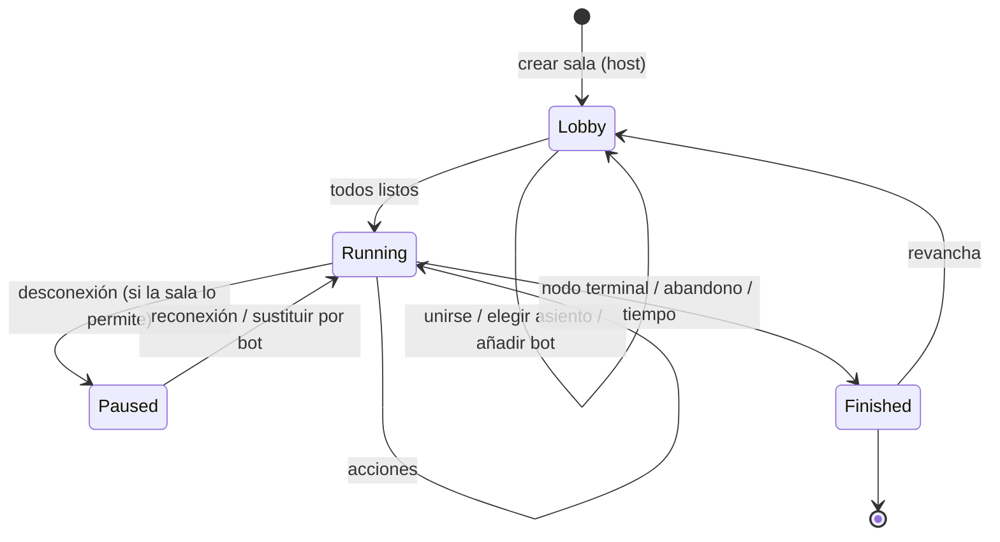

# Protocolo de partidas ("el juego como API")

> Estado: **borrador v0.1** (Fase 0). Esquemas previstos en `spec/protocol/`.

## 1. Principios

- **Servidor autoritativo:** el servidor tiene el estado real; cada cliente recibe **solo su vista
  redactada**. Imposible hacer trampas leyendo la memoria del cliente.
- **Agnóstico de la interfaz:** CLI, web, Godot, Unity o un bot hablan exactamente el mismo
  protocolo. Un bot *es* un cliente.
- **Transporte:** WebSocket + JSON en v1 (MessagePack opcional después). Lobby por REST.
- **Tipado:** todos los mensajes tienen JSON Schema → tipos generados para Python y TypeScript.
- **Versionado:** `protocol: 1` en el saludo; el juego se identifica por *hash de reglas* y la
  compatibilidad de UIs por *hash de interfaz* (ver [GameIR](ir.md)).

## 2. Conceptos

| Concepto | Definición |
|---|---|
| **Sala** (room) | Instancia de un juego@versión con parámetros. Tiene un **código** (6 caracteres Crockford base32 sin ambiguos, p. ej. `K7F-Q2P`). |
| **Asiento** (seat) | Posición en las reglas (0..n-1). Tipos: `open`, `human`, `bot`, `reserved`. |
| **Participante** | Quien ocupa un asiento (o espectador). Tiene un token de sesión para reconectarse. |
| **Partida** (match) | Ejecución concreta: semilla, secuencia de acciones, replay. Una sala puede encadenar varias. |



## 3. Lobby (REST)

| Método | Ruta | Descripción |
|---|---|---|
| `POST` | `/rooms` | `{game, version, params, settings}` → `{code, host_token}` |
| `GET` | `/rooms/{code}` | Estado público de la sala |
| `GET` | `/games/{id}@{version}/ir` | IR del juego (para UIs y bots que la necesiten) |
| `GET` | `/games/{id}@{version}/interface` | Esquemas de vista, acciones y eventos |
| `GET` | `/replays/{id}` | Replay (vista omnisciente tras terminar) |

## 4. Mensajes WebSocket

Sobre: `{"v": 1, "type": "...", "id": "uuid", "data": {...}}`

**Cliente → servidor**

| Tipo | Datos | Notas |
|---|---|---|
| `hello` | `{token?, client, protocol}` | Primer mensaje |
| `join` | `{room, as: player\|spectator, seat?, name}` | |
| `ready` | `{ready}` | |
| `act` | `{seq, action: {name, args}}` | `seq` = última actualización vista (evita acciones obsoletas) |
| `query_actions` | `{seq, prefix: {name, args parciales}}` | Construcción progresiva (eliges pieza → destinos legales) |
| `offer` / `respond` | `{kind: draw\|undo\|pause}` / `{offer_id, accept}` | Si el juego/sala lo permite |
| `resign`, `chat`, `ping`, `resync` | | |

**Servidor → cliente**

| Tipo | Datos |
|---|---|
| `welcome` | `{session_token, protocol}` |
| `room` | `{code, game: {id, version, rules_hash}, params, seats[], status}` |
| `match_start` | `{seat, rng_commitment, interface_hash}` |
| `update` | `{seq, view, events[], active[], legal?, clocks?, deadline?}` |
| `actions` | Respuesta a `query_actions` |
| `rejected` | `{seq, reason: illegal_action\|stale_seq\|not_your_turn\|timeout, detail}` |
| `match_end` | `{payoffs, ranking, rng_reveal, replay_id}` |
| `chat`, `pong`, `error` | |

**Ejemplo** — `update` para el asiento 1 en Póker de Kuhn (de la mano rival solo se ve el tamaño, [ADR-019](decisiones.md)):

```json
{ "v": 1, "type": "update", "data": {
    "seq": 3,
    "view": {
      "node": "Act",
      "hand": { "0": { "size": 1 },
                "1": { "size": 1, "items": ["K"] } },
      "put": { "0": 2, "1": 1 },
      "moves": ["Bet"]
    },
    "events": [ { "type": "action", "seat": 0, "name": "bet" } ],
    "active": [1],
    "legal": { "kind": "enumerated", "actions": [ { "name": "call" }, { "name": "fold" } ] }
} }
```

## 5. Acciones legales

- **Enumeradas** cuando son pocas (`[{name, args}]`).
- **Por esquema** cuando son muchas: `{"name": "raise", "params": [{"name": "amount", "type": "Int", "range": [20, 940]}]}`.
- **Progresivas** con `query_actions` para acciones con varios parámetros (ajedrez: origen →
  destino → promoción; Skat: tipo de juego → hand → schneider…).

## 6. Orden, idempotencia y reconexión

- `seq` monótono por partida; un `act` con `seq` antiguo se rechaza (`stale_seq`).
- `id` de mensaje para idempotencia (reintentos seguros).
- Reconexión con `session_token` → el servidor reenvía `room` + `update` completo.
- En nodos `race` (velocidad) manda la **marca de tiempo del servidor**.

## 7. Tiempo

Controles configurables por sala (sin reloj, por jugada, reloj de ajedrez con incremento). Los
relojes viajan en cada `update`. Al vencer un plazo se aplica el `on_timeout` del juego o, si no
lo define, el de la sala (pasar, acción aleatoria legal, sustituir por bot, perder).

## 8. Azar verificable ("provably fair")

1. Al empezar: el servidor publica `commitment = SHA-256(server_seed ‖ salt)`; opcionalmente cada
   cliente aporta su propia semilla.
2. Semilla de la partida = `H(server_seed ‖ client_seeds…)`.
3. Al terminar: se revelan `server_seed` y `salt`; cualquiera puede re-simular el replay y comprobar
   cada barajado.

Esto impide manipular el azar a mitad de partida. (Para partidas sin árbitro de confianza
—P2P puro— existe la familia de protocolos *mental poker*; queda como trabajo futuro.)

## 9. Modos de conexión

| Modo | Cómo |
|---|---|
| **Local / hot-seat** | Mismo dispositivo; el cliente web ejecuta el motor (WASM) con los mismos mensajes en proceso. |
| **LAN** | `gamehub host wizard` → código + URL + QR (`http://192.168.1.20:7420/r/K7FQ2P`); descubrimiento mDNS `_gamehub._tcp`. |
| **Online** | Salas alojadas en el hub o en un servidor propio; *relay* para NAT. |
| **Bots** | `gamehub bot run mi_agente.py --room K7FQ2P --seat 1`, o "añadir bot" en el lobby (sandbox). |

## 10. SDKs y tipos generados

- SDK de cliente: **TypeScript** y **Python** primero; Godot (GDScript) y C# (Unity) después.
- `gamehub sdk ts wizard` genera **tipos específicos del juego** (vista, acciones, eventos) a partir
  del hash de interfaz: una UI propia tiene autocompletado y errores de compilación si las
  reglas cambian de forma incompatible.
