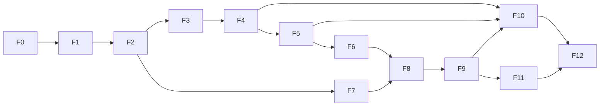

# Roadmap: de 0 % a 100 %

> Estado: **v0.1** (2026-10-09). Los checkboxes se marcan a medida que avanza el proyecto; el %
> global se calcula con el peso de cada fase. **Progreso actual: ≈ 51 % (F0 a F4 en `main`; F5
> completa en su rama, pendiente de tu visto bueno para fusionarla).**

## Resumen

| Fase | Nombre | Peso | % acumulado | Hito |
|---|---|---:|---:|---|
| F0 | Fundamentos y especificación | 4 | 4 | |
| F1 | Motor de referencia (Python) + IR v0 | 9 | 13 | Se juega en terminal |
| F2 | Lenguaje `.game` + toolchain + stdlib v0 + paquetes | 11 | 24 | Se diseña en texto |
| F3 | Servidor de partidas + protocolo + LAN/online | 8 | 32 | Se juega en red (CLI) |
| F4 | Cliente web: SDK TS, UI genérica, UI kit, lobby | 9 | 41 | **MVP jugable** |
| F5 | Studio: editor visual bidireccional + simulador | 10 | 51 | **MVP de diseño** |
| F6 | Catálogo ola 2 + stdlib madura | 8 | 59 | Los 7 juegos pedidos |
| F7 | Teoría de juegos v1 | 7 | 66 | Nash, árbol, matriz, CGT |
| F8 | Core C++ + bindings + WASM | 9 | 75 | ×50 de velocidad |
| F9 | Heurísticas, bots, arena, analítica de balance | 7 | 82 | |
| F10 | Hub web (GitHub de juegos) | 9 | 91 | Plataforma pública |
| F11 | IA: RL, Deep RL, LLM | 7 | 98 | |
| F12 | Endurecimiento y versión 1.0 | 2 | 100 | **1.0** |

**Reglas del roadmap**
- Cada fase termina con: tests en verde, wiki actualizada, entrada en `log.md`, juegos de ejemplo
  funcionando y decisiones registradas en [decisiones](decisiones.md).
- Se trabaja en **cortes verticales**: cuanto antes, algo que se pueda usar de punta a punta.
- Tamaños: S (días), M (1–2 semanas), L (3–6 semanas), XL (más) — orientativos para una
  persona con ayuda de IA.

---

## F0 — Fundamentos y especificación (0 → 4 %) · S–M

**Objetivo:** fijar el modelo y los contratos antes de escribir el motor.

- [x] Wiki inicial: visión, modelo formal, lenguaje, IR, arquitectura, protocolo, roadmap
- [x] Resolver las [preguntas abiertas](preguntas-abiertas.md) bloqueantes (licencia, nombre, sintaxis, Mentiroso)
- [x] `git init` (rama `main`), estructura de monorepo (`spec/`, `python/`, `docs/`), `.editorconfig`, `.gitignore`, `LICENSE` + `LICENSING.md`
- [x] Entorno Python (`uv`), `ruff`, `pyright`, `pytest`, `pre-commit` (hooks locales)
- [x] CI (GitHub Actions): lint, formato, tipos, esquemas, juegos de validación, tests — *se ejecutará cuando haya remoto*
- [x] JSON Schema de la **IR núcleo** en `spec/ir/v0/` + catálogo de operadores `ops.json` con esquemas generados (la IR de autor pasa a F2, [ADR-021](decisiones.md))
- [x] IR escrita a mano para **4** juegos de validación: tres en raya, dilema del prisionero, Kuhn y **Mentiroso**
- [x] Validador `gamehub ir check` (esquema + buena formación) con 35 tests, incluidos 20 casos de error
- [x] RFC de sintaxis Nomos v0.1 aprobado ([lenguaje §10](lenguaje-game.md))

**Aceptación:** ✅ el esquema y el validador aceptan las 4 IR y rechazan los 20 casos de error;
✅ ADR aceptadas (2026-10-09).

## F1 — Motor de referencia en Python + IR v0 (4 → 13 %) · L

**Objetivo:** ejecutar cualquier juego descrito en IR, de forma determinista, con vistas por jugador.

- [x] `gamehub.ir`: validación (JSON Schema + buena formación, sin pydantic: ADR-023) y **hash
      canónico** (JCS + SHA-256, insensible a valores por defecto: ADR-025)
- [x] Valores y tipos en tiempo de ejecución (enteros, racionales exactos, enums, structs,
      colecciones, zonas ordenadas y bolsas, rejillas) — *los grafos pasan a F6 (Parchís)*
- [x] Evaluador de expresiones puro: los 87 operadores, compilados a funciones
- [x] Ejecutor de efectos: las 14 sentencias, con eventos redactados por asiento
- [x] Intérprete del flow: `decision`, `simultaneous`, `window` (priority/collect/race), `chance`,
      `auto`, `phase` (`on_enter`/`on_exit`/`$exit`), `terminal`; avance hasta quiescencia sin recursión
- [x] Azar: **PCG32** normativo (ADR-022), flujos separados, resultados enumerables (probabilidad
      exacta) o muestreables
- [x] Visibilidad: vistas redactadas, eventos filtrados y estados de información con recuerdo perfecto
- [x] API de motor ([motor](motor.md)) con estados inmutables, historial, instantánea y huella
- [x] Acciones legales: enumeración, forma canónica y construcción progresiva (`options`)
- [x] **Replays** `.ghr.json` (sorteos explícitos + huella por paso) y re-simulación verificada
- [x] API Python *builder* (`gamehub.build`), validada contra los JSON escritos a mano
- [x] CLI: `gamehub play` (hot-seat y bots), `gamehub fuzz`, `gamehub replay`, `gamehub conformance`
- [x] Juegos ejecutables: tres en raya, dilema del prisionero, Kuhn, Mentiroso, **piedra-papel-tijera
      y Nim**; trazas doradas de conformidad para los 6

**Aceptación:** 10⁵ playouts aleatorios por juego sin errores; replays idénticos bit a bit; tests
de vistas demuestran que en Kuhn nadie ve la carta rival; partida completa jugable en terminal.
Resultado: ver el [log](../../log.md) del 2026-10-09 (sesión 3).

## F2 — Lenguaje `.game`, toolchain, stdlib v0 y paquetes (13 → 24 %) · L–XL

**Objetivo:** diseñar juegos escribiendo texto, con errores claros y herramientas de verdad.

- [x] Gramática (escrito a mano, no Lark) y parser con posiciones; recuperación de errores
- [x] AST → resolución de nombres → **comprobador de tipos** → *lowering* → IR resuelta
- [x] Diagnósticos estilo `rustc` (línea, columna, subrayado, sugerencia)
- [x] `gamehub check`: tipos, nodos inalcanzables, transiciones no exhaustivas, bucles sin
      progreso, **fugas de información** (v1 sencilla), clasificación del juego
- [x] `gamehub fmt`: formateador canónico que conserva comentarios (round-trip probado)
- [x] Módulos e `import`; `extends` / `override` / `remove` / `extend node` (mods); combinadores (`repeat`, `best_of`)
- [x] Bloques `test` e `invariant`; `gamehub test` (invariantes también en partidas aleatorias)
- [x] **stdlib v0**: `std.cards` (French52, Spanish40/48), `std.dice`, `std.grid`, `std.graph`
- [x] Paquetes: `game.toml`, `game.lock`, `gamehub new`, `gamehub clone <url-git>`, `gamehub fork` (y `gamehub fetch`)
- [x] `gamehub diff a..b`: **diff semántico** de IR entre dos versiones
- [x] `gamehub viz`: diagrama de solo lectura (Mermaid / Graphviz) — primer "editor visual"
- [x] `gamehub rules`: **reglamento autogenerado** v0 (Markdown)
- [x] Extensión VS Code: resaltado (TextMate) + diagnósticos (+ formato) en `editors/vscode/nomos`
- [x] Juegos en `.game`: los de F1 (incluido Mentiroso) + Conecta 4, familia 2×2, PD iterado, Leduc, Dudo

**Aceptación:** todos los juegos de la ola 1 en `.game` pasan sus tests; `fmt` idempotente;
`texto → IR → texto` estable; el diagrama de `viz` coincide con el flow.
Resultado: ✅ 16 juegos en `.game` (64 comprobaciones de `gamehub test` en verde, ningún aviso de
`check`); `fmt` idempotente y estable a cualquier ancho; ida y vuelta exacta con el
descompilador; `viz` con una caja por nodo y una flecha por transición (tests). Ver el
[log](../../log.md) del 2026-10-09 (sesión 4).

## F3 — Servidor de partidas y protocolo (24 → 32 %) · L

**Objetivo:** el juego como API: alguien hospeda, se genera un código, los demás se unen.

- [x] `spec/protocol/` v1 (JSON Schema) + tipos generados (Python) — `gamehub protocol types`
- [x] Servidor Starlette + WebSocket ([ADR-036](decisiones.md)): salas, códigos, asientos (`open/human/bot/reserved`), anfitrión
- [x] Proyección por asiento en cada `update`; validación de `act` con `seq` (turno vigente)
- [x] Reconexión con token y `resume`, espectadores (vista pública u omnisciente, con retardo opcional), revancha
- [x] Relojes y plazos (`move`, `match`), `on_timeout` de la sala (el de cada juego, con la IR v0.2)
- [x] Azar verificable (commit–reveal, `gamehub-fair/1`; `gamehub replay` lo comprueba)
- [x] Persistencia de partidas y replays (SQLite; las partidas cortadas por una caída se recuperan)
- [x] LAN: `gamehub host`, código + URL + QR, descubrimiento mDNS; `gamehub join`, `gamehub rooms`
- [x] SDK cliente Python + interfaz `Agent`; `gamehub bot run agente.py --room CODE`
- [x] Cliente de terminal para jugar en red
- [x] Pruebas de carga (100 salas simultáneas, `gamehub loadtest`) y límites básicos (tokens, tasa, tamaños, salas, conexiones)

**Aceptación:** 4 personas en 4 ordenadores de la misma LAN juegan Dudo desde la CLI; un bot
se une a una sala por código; desconectar y reconectar no rompe la partida.
Resultado: ✅ prueba con procesos reales (`tests/test_acceptance_f3.py`, `GAMEHUB_LAN_TESTS=1`):
`gamehub host` de Dudo en la IP de la LAN y cuatro `gamehub join` con datos propios (dos
encuentran la sala por mDNS, dos entran por el enlace); a uno se le cae la terminal en su turno y
vuelve; la partida termina; en la revancha un bot entra por el código. Cinco de cinco. Carga:
100 salas de Dudo a 4 (400 conexiones) ≈ 890 jugadas/s sin fallos. Ver el
[log](../../log.md) del 2026-10-10.

## F4 — Cliente web: SDK TS, UI genérica y UI kit (32 → 41 %) · L — **MVP JUGABLE**

**Objetivo:** jugar a cualquier juego en el navegador y poder construir UIs propias fácilmente.

- [x] Monorepo de JavaScript (pnpm en la raíz: `web/` y `games/*/ui`; Vite, TypeScript 7, React 19, Biome, Vitest) — [ADR-044](decisiones.md)
- [x] `@gamehub/protocol` (tipos generados con el mismo generador que los de Python) y `@gamehub/client` (WS, reconexión con `resume`, estado inmutable, acciones progresivas, sesiones, REST)
- [x] `@gamehub/auto-ui`: **UI genérica** a partir de la IR (zonas, tableros, contadores, cartas,
      dados, acciones como pulsaciones, botones o formularios, registro de eventos, resultado)
- [x] `@gamehub/ui-kit`: Rejilla, Carta, Mano (abanico), Pila, Mazo, Dado, Ficha, Recorrido/Grafo,
      Marcador, Reloj, Barra de acciones (más insignia de jugador, contador, fichas de apuesta)
- [x] Sección `ui { … }` del `.game` (pistas de renderizado) interpretada por auto-ui — en los 15 paquetes del catálogo
- [x] App `play`: crear/unirse con código, enlace o QR, elegir asiento, añadir bots, partida, espectador, revancha, replays paso a paso
- [x] Modo local hot-seat (con pantalla de privacidad si hay información oculta)
- [x] Generador `gamehub ui new --template react` + `gamehub sdk ts <juego>` (tipos por juego)
- [x] UIs propias de ejemplo: tres en raya, Conecta 4, Dudo
- [x] i18n es/en; diseño responsive (móvil)

**Aceptación:** todos los juegos del catálogo se juegan en el navegador con la UI genérica; una UI
propia nueva se crea en < 1 hora con la plantilla; partida online entre navegador y CLI.
Resultado: ✅ los 15 juegos del catálogo se juegan enteros contra el servidor solo pulsando la UI
genérica (test de integración, al azar con semilla); la plantilla funciona a la primera (tipos,
test, lint y servidor de desarrollo) y con ella se hicieron las UIs del tres en raya, Conecta 4 y
Dudo (de 150 a 270 líneas cada una); Ana en la app contra Luis con `gamehub join` en una terminal
de verdad, hasta el final (test de aceptación). Revisado en el navegador, también a tamaño de
móvil. Ver el [log](../../log.md) del 2026-10-11 y el [cliente web](cliente-web.md).

## F5 — Studio: editor visual bidireccional (41 → 51 %) · XL — **MVP DE DISEÑO**

**Objetivo:** diseñar un juego completo sin escribir texto (o escribiéndolo, a elegir), y
probarlo en el mismo sitio. Ver [Studio](studio-editor-visual.md).

- [x] `gamehub studio`: servidor local + app web (token, Host y Origin comprobados; la rueda la lleva)
- [x] LSP de GameHub (`pygls`): diagnósticos, autocompletado, *hover*, ir a definición, renombrar
      (y referencias, formato, esquema, plegado, firmas, arreglos rápidos; `gamehub lsp`)
- [x] ~~Monaco~~ **CodeMirror 6** con el LSP (ADR-054); lienzo React Flow + ELK; *sidecar* `.layout.json`
- [x] **Sincronización bidireccional** texto ↔ diagrama vía IR de autor (tests de propiedad)
- [x] Paleta de nodos, conexiones, fases plegables, inspector de nodos/acciones/transiciones
- [x] Editor del esquema de estado con visibilidad; diseñador de componentes (barajas, tableros de
      rejilla y de grafo, dados); tests e invariantes editables y ejecutables
- [x] Panel de problemas en vivo + clasificación + tamaño estimado (Knuth)
- [x] Simulador: jugar como cualquier asiento, vistas lado a lado, vista omnisciente, paso a paso,
      playouts, puntos de ruptura (nodos y condiciones), **viaje en el tiempo**, cobertura de reglas
      en el diagrama
- [x] Explorador de árbol (juegos pequeños)
- [x] Plantillas de juego; exportar diagrama SVG/PNG; diff visual entre dos versiones

**Aceptación:** crear el tres en raya desde cero solo con el diagrama y jugarlo; modificar el flow de
Dudo en el diagrama y ver el texto actualizado (y viceversa) sin perder comentarios.
Resultado: ✅ el tres en raya se construye desde la plantilla vacía solo con las operaciones de
la paleta, las flechas y el inspector (24 gestos), pasa sus tests, se juega en el simulador y es
el mismo juego que el del catálogo (mismas jugadas legales y pagos en partidas al azar); en Dudo,
añadir un nodo, reconectar una flecha (cambia una línea), reordenar acciones y meter la ronda en
una fase no pierde ningún comentario (los 16 del archivo, `///` incluidos, y 4 más repartidos por
el flow para la prueba), y lo escrito en el texto (también roto y arreglado) llega al diagrama. Tests de aceptación contra el servidor del Studio de verdad
(`python/tests/test_studio_acceptance.py`), la app entera manejada en jsdom (paleta, inspector,
texto y simulador) y revisión en el navegador. Ver el [log](../../log.md) del 2026-10-12 y el
[Studio](studio-editor-visual.md).

## F6 — Catálogo ola 2 + stdlib madura (51 → 59 %) · XL

- [ ] stdlib: `std.tricktaking`, `std.bidding`, `std.betting` (botes secundarios), `std.poker`
      (evaluador), `std.boards` (rayos/direcciones, grafos de recorrido), barajas Skat32 y Wizard60
- [ ] Interfaz de **plugins nativos** (WASM preferente) con implementación de referencia obligatoria
- [ ] Juegos: **Parchís, Wizard, Solitario, Ajedrez, Texas Hold'em, Skat** (Mentiroso ya llega en F2; definición
      de "terminado" en el [catálogo](catalogo-de-juegos.md))
- [ ] UIs propias: Parchís, Wizard, Ajedrez, Póker (las demás con UI genérica + ui-kit)
- [ ] Perfilado y optimización del motor de referencia (cachés de legalidad, evaluación incremental)

**Aceptación:** *perft(5)* del ajedrez = 4 865 609; puntuaciones de Skat verificadas con
ejemplos oficiales; 10⁵ playouts de cada juego sin errores; los 7 juegos pedidos jugables online.

## F7 — Teoría de juegos v1 (59 → 66 %) · L

Ver [teoría de juegos](teoria-de-juegos.md).

- [ ] Asesor de viabilidad (clasificación + estimador de Knuth + recomendación)
- [ ] Constructor de árbol/DAG y forma normal (directa y por estrategias reducidas)
- [ ] Solvers: minimax/alfa-beta/expectimax, inducción hacia atrás (SPE), equilibrios puros,
      dominancia iterada, *support enumeration*, Lemke–Howson, PL suma cero (HiGHS), correlacionado,
      Pareto, bienestar, PoA/PoS
- [ ] Info imperfecta: CFR/CFR+ tabular, mejor respuesta, explotabilidad
- [ ] CGT: Grundy, clases de resultado; cooperativos: v(C), Shapley, núcleo, nucléolo
- [ ] Torneos de juegos repetidos (Axelrod)
- [ ] Exportar a Gambit (`.efg`/`.nfg`) y envolver como juego OpenSpiel
- [ ] `gamehub analyze`, widgets para notebooks, pestaña "Análisis" en Studio

**Aceptación:** reproducir todos los resultados de referencia ([§6](teoria-de-juegos.md)).

## F8 — Core C++ + bindings + WASM (66 → 75 %) · XL

- [ ] Representación compacta del estado (arena de memoria, bitboards cuando el esquema lo permita)
- [ ] Compilador IR → bytecode y **VM**; efectos, azar, visibilidad, eventos
- [ ] Bindings `nanobind` con la misma API que el motor de referencia
- [ ] **Suite de conformidad diferencial** (Python vs C++ en millones de playouts)
- [ ] Hash Zobrist automático; *undo* incremental para búsqueda
- [ ] Algoritmos en C++: alfa-beta, MCTS, CFR/MCCFR, análisis retrógrado
- [ ] Generación de código IR → C++ para juegos "calientes" (opcional)
- [ ] Build WASM (Emscripten) usado por `play` y Studio sin servidor

**Aceptación:** ≥ 50× más playouts/s que Python en tres en raya, Conecta 4 y Kuhn; trazas idénticas.

## F9 — Heurísticas, bots, arena y analítica de balance (75 → 82 %) · L

Ver [heurísticas e IA](heuristicas-e-ia.md).

- [ ] Bloques `heuristic` (rasgos + combinación + orden de jugadas) evaluados en C++
- [ ] Bots: reglas por prioridad, minimax+heurística, MCTS, ISMCTS, PIMC
- [ ] Ajuste de pesos (CMA-ES, SPSA, Texel)
- [ ] Empaquetado y sandbox de bots; bots remotos por protocolo
- [ ] Arena: torneos, partidas espejo, Elo/Glicko-2/TrueSkill por hash de reglas, SPRT
- [ ] Analítica de balance (ventaja por asiento, habilidad vs. suerte, *skill chain*, cobertura…)
- [ ] Informe "Balance CI" comparando dos versiones de un juego

**Aceptación:** torneo round-robin automático en 5 juegos; informe de balance de Parchís y Wizard.

## F10 — Hub web (82 → 91 %) · XL

Ver [hub](hub.md).

- [ ] Backend: FastAPI + PostgreSQL + almacenamiento de objetos + git (Forgejo o servicio propio)
- [ ] Cuentas (OAuth), organizaciones, repos de juego y de biblioteca
- [ ] Página de juego: reglas + diagrama, código, **Jugar**, análisis, bots, interfaces, variantes
- [ ] Registro de versiones con hashes; **semver automático**; dependencias
- [ ] Forks, ramas, propuestas (PR) con diff textual, semántico, visual y de balance
- [ ] Salas alojadas, emparejamiento, ratings humanos
- [ ] Búsqueda por propiedades matemáticas; árbol genealógico; Pages para UIs
- [ ] Colas de trabajos (análisis, arena) en sandbox; cuotas; moderación; términos de uso

**Aceptación:** A publica un juego, B lo bifurca, crea una variante y abre un PR con diffs; A lo
fusiona; cualquiera juega la nueva versión online desde el navegador.

## F11 — IA: RL, Deep RL, LLM (91 → 98 %) · XL

- [ ] Tensorización automática de observaciones y acciones desde la IR
- [ ] Adaptadores Gymnasium / PettingZoo / OpenSpiel; entornos vectorizados en C++
- [ ] Recetas: PPO, DQN; **AlphaZero** (MCTS C++ + PyTorch); NFSP, Deep CFR, PSRO
- [ ] Registro de modelos, exportación ONNX, inferencia en C++ y navegador
- [ ] Agentes LLM; diseño asistido (lenguaje natural → `.game`)
- [ ] Panel de entrenamiento; publicación de agentes en la arena

**Aceptación:** AlphaZero supera a MCTS puro en Conecta 4; Deep CFR alcanza explotabilidad
objetivo en Leduc; un agente LLM juega partidas legales completas de Wizard.

## F12 — Endurecimiento y versión 1.0 (98 → 100 %) · M

- [ ] Congelar `ir_version` 1.0, protocolo v1 y sintaxis 1.0 (garantías de compatibilidad)
- [ ] Auditoría de seguridad; escalado horizontal de salas; observabilidad; copias de seguridad
- [ ] Web de documentación (MkDocs Material) a partir de esta wiki; tutoriales
- [ ] Gobernanza del proyecto, guía de contribución, licencias revisadas

---

## Trabajo transversal (todas las fases)

Documentación y `log.md` al día · tests y CI · rendimiento medido · accesibilidad · i18n ·
seguridad · ejemplos actualizados · decisiones registradas.

## Próximos pasos inmediatos

1. Responder las [preguntas abiertas](preguntas-abiertas.md) marcadas como bloqueantes.
2. Cerrar F0: repo, herramientas, JSON Schema de la IR y las 3 IR de validación.
3. Empezar F1 por el núcleo mínimo para el tres en raya y crecer juego a juego.
