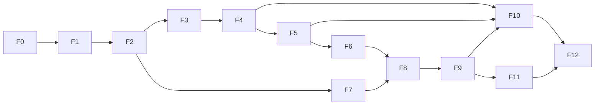

# Roadmap: from 0 % to 100 %

> Status: **v0.1** (2026-10-09). Checkboxes are ticked as the project moves forward; the overall
> % is computed with the weight of each phase. **Current progress: ≈ 73 % (F0 to F7 in `main`; F8
> on its branch, everything but the WASM build and the optional code generation).**

## Summary

| Phase | Name | Weight | Cumulative % | Milestone |
|---|---|---:|---:|---|
| F0 | Foundations and specification | 4 | 4 | |
| F1 | Reference engine (Python) + IR v0 | 9 | 13 | Played in the terminal |
| F2 | `.game` language + toolchain + stdlib v0 + packages | 11 | 24 | Designed as text |
| F3 | Match server + protocol + LAN/online | 8 | 32 | Played over the network (CLI) |
| F4 | Web client: TS SDK, generic UI, UI kit, lobby | 9 | 41 | **Playable MVP** |
| F5 | Studio: bidirectional visual editor + simulator | 10 | 51 | **Design MVP** |
| F6 | Catalog wave 2 + mature stdlib | 8 | 59 | The 7 requested games |
| F7 | Game theory v1 | 7 | 66 | Nash, tree, matrix, CGT |
| F8 | C++ core + bindings + WASM | 9 | 75 | ×50 speed |
| F9 | Heuristics, bots, arena, balance analytics | 7 | 82 | |
| F10 | Web hub (GitHub for games) | 9 | 91 | Public platform |
| F11 | AI: RL, Deep RL, LLM | 7 | 98 | |
| F12 | Hardening and version 1.0 | 2 | 100 | **1.0** |

**Roadmap rules**
- Every phase ends with: green tests, an updated wiki, a `log.md` entry, working example games and
  decisions recorded in [decisions](decisions.md).
- Work happens in **vertical slices**: as early as possible, something usable end to end.
- Sizes: S (days), M (1–2 weeks), L (3–6 weeks), XL (more) — indicative, for one person with AI
  help.

---

## F0 — Foundations and specification (0 → 4 %) · S–M

**Goal:** settle the model and the contracts before writing the engine.

- [x] Initial wiki: vision, formal model, language, IR, architecture, protocol, roadmap
- [x] Resolve the blocking [open questions](open-questions.md) (license, name, syntax, Bullshit)
- [x] `git init` (branch `main`), monorepo layout (`spec/`, `python/`, `docs/`), `.editorconfig`, `.gitignore`, `LICENSE` + `LICENSING.md`
- [x] Python environment (`uv`), `ruff`, `pyright`, `pytest`, `pre-commit` (local hooks)
- [x] CI (GitHub Actions): lint, formatting, types, schemas, validation games, tests — *it will run once there is a remote*
- [x] JSON Schema of the **core IR** in `spec/ir/v0/` + operator catalog `ops.json` with generated schemas (the authoring IR moves to F2, [ADR-021](decisions.md))
- [x] Hand-written IR for **4** validation games: tic-tac-toe, prisoner's dilemma, Kuhn and **Bullshit**
- [x] `gamehub ir check` validator (schema + well-formedness) with 35 tests, including 20 error cases
- [x] Nomos syntax RFC v0.1 approved ([language §17](language.md))

**Acceptance:** ✅ the schema and the validator accept the 4 IRs and reject the 20 error cases;
✅ ADRs accepted (2026-10-09).

## F1 — Reference engine in Python + IR v0 (4 → 13 %) · L

**Goal:** run any game described in IR, deterministically, with per-player views.

- [x] `gamehub.ir`: validation (JSON Schema + well-formedness, without pydantic: ADR-023) and a
      **canonical hash** (JCS + SHA-256, insensitive to default values: ADR-025)
- [x] Runtime values and types (integers, exact rationals, enums, structs, collections, ordered
      zones and bags, grids) — *graphs move to F6 (Parchís)*
- [x] Pure expression evaluator: the 87 operators, compiled into functions
- [x] Effect executor: the 14 statements, with events redacted per seat
- [x] Flow interpreter: `decision`, `simultaneous`, `window` (priority/collect/race), `chance`,
      `auto`, `phase` (`on_enter`/`on_exit`/`$exit`), `terminal`; advancing to quiescence without
      recursion
- [x] Chance: normative **PCG32** (ADR-022), separate streams, enumerable (exact probability) or
      sampleable outcomes
- [x] Visibility: redacted views, filtered events and information states with perfect recall
- [x] Engine API ([engine](engine.md)) with immutable states, history, snapshot and digest
- [x] Legal actions: enumeration, canonical form and progressive building (`options`)
- [x] **Replays** `.ghr.json` (explicit draws + digest per step) and verified re-simulation
- [x] Python *builder* API (`gamehub.build`), validated against the hand-written JSON
- [x] CLI: `gamehub play` (hot-seat and bots), `gamehub fuzz`, `gamehub replay`, `gamehub conformance`
- [x] Runnable games: tic-tac-toe, prisoner's dilemma, Kuhn, Bullshit, **rock-paper-scissors and
      Nim**; golden conformance traces for all 6

**Acceptance:** 10⁵ random playouts per game without errors; replays identical bit for bit; view
tests show that in Kuhn nobody sees the opponent's card; a full match playable in the terminal.
Result: see the [log](../../log.md) of 2026-10-09 (session 3).

## F2 — `.game` language, toolchain, stdlib v0 and packages (13 → 24 %) · L–XL

**Goal:** design games by writing text, with clear errors and real tools.

- [x] Grammar (hand-written, not Lark) and a parser with positions; error recovery
- [x] AST → name resolution → **type checker** → *lowering* → resolved IR
- [x] `rustc`-style diagnostics (line, column, underline, suggestion)
- [x] `gamehub check`: types, unreachable nodes, non-exhaustive transitions, loops without
      progress, **information leaks** (a simple v1), game classification
- [x] `gamehub fmt`: a canonical formatter that preserves comments (round trip tested)
- [x] Modules and `import`; `extends` / `override` / `remove` / `extend node` (mods); combinators (`repeat`, `best_of`)
- [x] `test` and `invariant` blocks; `gamehub test` (invariants also on random matches)
- [x] **stdlib v0**: `std.cards` (French52, Spanish40/48), `std.dice`, `std.grid`, `std.graph`
- [x] Packages: `game.toml`, `game.lock`, `gamehub new`, `gamehub clone <git-url>`, `gamehub fork` (and `gamehub fetch`)
- [x] `gamehub diff a..b`: **semantic diff** of the IR between two versions
- [x] `gamehub viz`: a read-only diagram (Mermaid / Graphviz) — the first "visual editor"
- [x] `gamehub rules`: **generated rulebook** v0 (Markdown)
- [x] VS Code extension: highlighting (TextMate) + diagnostics (+ formatting) in `editors/vscode/nomos`
- [x] Games in `.game`: those of F1 (including Bullshit) + Connect Four, the 2×2 family, iterated PD, Leduc, Dudo

**Acceptance:** every wave-1 game in `.game` passes its tests; `fmt` idempotent; `text → IR →
text` stable; the `viz` diagram matches the flow.
Result: ✅ 16 games in `.game` (64 `gamehub test` checks green, no `check` warnings); `fmt`
idempotent and stable at any width; exact round trip with the decompiler; `viz` with one box per
node and one arrow per transition (tests). See the [log](../../log.md) of 2026-10-09 (session 4).

## F3 — Match server and protocol (24 → 32 %) · L

**Goal:** the game as an API: someone hosts, a code is generated, the others join.

- [x] `spec/protocol/` v1 (JSON Schema) + generated types (Python) — `gamehub protocol types`
- [x] Starlette + WebSocket server ([ADR-036](decisions.md)): rooms, codes, seats (`open/human/bot/reserved`), host
- [x] Per-seat projection in each `update`; `act` validation with `seq` (current turn)
- [x] Reconnection with token and `resume`, spectators (public or omniscient view, with an optional delay), rematch
- [x] Clocks and deadlines (`move`, `match`), the room's `on_timeout` (each game's own, with IR v0.2)
- [x] Provably fair chance (commit–reveal, `gamehub-fair/1`; `gamehub replay` checks it)
- [x] Persistence of matches and replays (SQLite; matches cut short by a crash are recovered)
- [x] LAN: `gamehub host`, code + URL + QR code, mDNS discovery; `gamehub join`, `gamehub rooms`
- [x] Python client SDK + `Agent` interface; `gamehub bot run agent.py --room CODE`
- [x] Terminal client to play over the network
- [x] Load tests (100 simultaneous rooms, `gamehub loadtest`) and basic limits (tokens, rate, sizes, rooms, connections)

**Acceptance:** 4 people on 4 computers on the same LAN play Dudo from the CLI; a bot joins a room
by code; disconnecting and reconnecting does not break the match.
Result: ✅ a test with real processes (`tests/test_acceptance_f3.py`, `GAMEHUB_LAN_TESTS=1`):
`gamehub host` of Dudo on the LAN IP and four `gamehub join`s with their own data (two find the
room over mDNS, two join through the link); one of them loses their terminal on their turn and
comes back; the match ends; in the rematch a bot joins by code. Five out of five. Load: 100 Dudo
rooms of 4 (400 connections) ≈ 890 moves/s without failures. See the [log](../../log.md) of
2026-10-10.

## F4 — Web client: TS SDK, generic UI and UI kit (32 → 41 %) · L — **PLAYABLE MVP**

**Goal:** play any game in the browser and be able to build custom UIs easily.

- [x] JavaScript monorepo (pnpm at the root: `web/` and `games/*/ui`; Vite, TypeScript 7, React 19, Biome, Vitest) — [ADR-044](decisions.md)
- [x] `@gamehub/protocol` (types generated with the same generator as the Python ones) and `@gamehub/client` (WS, reconnection with `resume`, immutable state, progressive actions, sessions, REST)
- [x] `@gamehub/auto-ui`: **generic UI** from the IR (zones, boards, counters, cards, dice,
      actions as clicks, buttons or forms, event log, result)
- [x] `@gamehub/ui-kit`: Grid, Card, Hand (fan), Pile, Deck, Die, Token, Track/Graph, Scoreboard,
      Clock, Action bar (plus player badge, counter, betting chips)
- [x] The `.game` `ui { … }` section (rendering hints) interpreted by auto-ui — in the 15 catalog packages
- [x] `play` app: create/join with a code, link or QR code, pick a seat, add bots, match, spectator, rematch, step-by-step replays
- [x] Local hot-seat mode (with a privacy screen if there is hidden information)
- [x] Generator `gamehub ui new --template react` + `gamehub sdk ts <game>` (per-game types)
- [x] Example custom UIs: tic-tac-toe, Connect Four, Dudo
- [x] es/en i18n; responsive design (phones)

**Acceptance:** every catalog game can be played in the browser with the generic UI; a new custom
UI is created in < 1 hour with the template; an online match between a browser and the CLI.
Result: ✅ the 15 catalog games are played to the end against the server only by clicking the
generic UI (integration test, at random with a seed); the template works on the first try (types,
test, lint and development server) and the tic-tac-toe, Connect Four and Dudo UIs were made with
it (150 to 270 lines each); Ana in the app against Luis with `gamehub join` in a real terminal,
until the end (acceptance test). Reviewed in the browser, also at phone size. See the
[log](../../log.md) of 2026-10-11 and the [web client](web-client.md).

## F5 — Studio: bidirectional visual editor (41 → 51 %) · XL — **DESIGN MVP**

**Goal:** design a complete game without writing text (or writing it, as you prefer), and test it
in the same place. See [Studio](studio.md).

- [x] `gamehub studio`: local server + web app (token, Host and Origin checked; shipped in the wheel)
- [x] GameHub LSP (`pygls`): diagnostics, completion, hover, go to definition, rename (and
      references, formatting, outline, folding, signatures, quick fixes; `gamehub lsp`)
- [x] ~~Monaco~~ **CodeMirror 6** with the LSP (ADR-054); React Flow + ELK canvas; `.layout.json` *sidecar*
- [x] **Bidirectional sync** text ↔ diagram through the authoring IR (property tests)
- [x] Node palette, connections, collapsible phases, inspector for nodes/actions/transitions
- [x] State schema editor with visibility; component designer (decks, grid and graph boards,
      dice); editable and runnable tests and invariants
- [x] Live problems panel + classification + estimated size (Knuth)
- [x] Simulator: play as any seat, side-by-side views, omniscient view, step by step, playouts,
      breakpoints (nodes and conditions), **time travel**, rule coverage on the diagram
- [x] Tree explorer (small games)
- [x] Game templates; export the diagram as SVG/PNG; visual diff between two versions

**Acceptance:** create tic-tac-toe from scratch only with the diagram and play it; modify Dudo's
flow in the diagram and see the text updated (and vice versa) without losing comments.
Result: ✅ tic-tac-toe is built from the empty template only with palette operations, arrows and
the inspector (24 gestures), passes its tests, is played in the simulator and is the same game as
the catalog's (same legal moves and payoffs in random matches); in Dudo, adding a node,
reconnecting an arrow (one line changes), reordering actions and putting the round inside a phase
loses no comment (the file's 16, `///` included, and 4 more scattered through the flow for the
test), and what is written in the text (also broken and then fixed) reaches the diagram.
Acceptance tests against the real Studio server (`python/tests/test_studio_acceptance.py`), the
whole app driven in jsdom (palette, inspector, text and simulator) and a review in the browser.
See the [log](../../log.md) of 2026-10-12 and the [Studio](studio.md).

## F6 — Catalog wave 2 + mature stdlib (51 → 59 %) · XL

- [x] stdlib: `std.tricktaking`, `std.bidding`, `std.betting` (side pots), `std.poker`
      (evaluator), `std.boards` (rays/directions, tracks), Skat32 and Wizard60 decks
      (`std.cards`); Parchís did not need graphs: its track is a ring (`loop_path`)
- [x] **Native plugin** interface (WASM, ABI `gamehub-native/1`) with a mandatory reference
      implementation (`@native`, ADR-062); the `std.poker` evaluator written in WAT
- [x] Games: **Parchís, Wizard, Solitaire, Chess, Texas Hold'em, Skat** (Bullshit already arrived in
      F2; definition of "finished" in the [catalog](game-catalog.md), except for the heuristic bot,
      which arrives in F9)
- [x] Custom UIs: Parchís, Wizard, Chess, Poker (the rest with the generic UI + ui-kit)
- [x] Profiling and optimization of the reference engine: function memoization (ADR-060), Python
      code generated from the IR (ADR-063), integer shortcuts; `perft` and `fuzz --jobs` (ADR-061)

**Acceptance:** chess *perft(5)* = 4,865,609; Skat scores verified with official examples; 10⁵
playouts of each game without errors; the 7 requested games playable online.
Result: ✅ (except for Solitaire's 50,000 random matches with draw three, still running at merge
time)
- *perft(5)* = **4,865,609** from the initial position (131 s with 6 processes), and the *perft*
  counts of Kiwipete (d3 = 97,862), positions 3 (d4 = 43,238), 4 (d3 = 9,467), 5 (d3 = 62,379) and
  6 (d3 = 89,890) from the Chess Programming Wiki (`pytest -m slow`).
- Skat: the game values of the ISkO examples are Nomos tests: suit games with and without
  matadors, Grand Hand with Schneider announced, Grand Ouvert (192), the four Null games (23, 35,
  46 and 59), losing with Schneider against (doubled) and overbidding (2 × the bid).
- 10⁵ random matches of each game, **0 errors and 0 truncated** (`gamehub fuzz --jobs 6`): chess
  100,000; Skat 50,000 with 3 and 50,000 with 4; Wizard 25,000 with 3, 4, 5 and 6; Parchís 25,000
  with 2, 3 and 4 and 25,000 in pairs; Solitaire 50,000 with draw one (2026-10-17, 4.4 h: almost
  every random game reaches the 1,000-move cap); Texas Hold'em 16,667 with 2, 3, 4, 6, 8 and 10
  players (100,002). Solitaire's 50,000 with draw three were still
  running at merge time; their result goes to the log.
- The 22 catalog packages (23 games) are played to the end against the real server only with the
  generic UI (web app test), and the four new UIs have been tested in the browser.

See the [log](../../log.md) of 2026-10-16 and the [catalog](game-catalog.md).

## F7 — Game theory v1 (59 → 66 %) · L

See [game theory](game-theory.md).

- [x] Feasibility advisor (classification + Knuth's estimator + recommendation; exact counts or a
      bounded probe when the game is small) — ADR-071
- [x] Tree/DAG and normal-form builder (direct and through reduced strategies): the extensive form
      with the engine's information sets and merged chance outcomes, the state graph — ADR-068
- [x] Solvers: minimax/alpha-beta/expectimax, backward induction (SPE), pure equilibria, iterated
      dominance, support enumeration, Lemke–Howson, zero-sum LP (exact simplex; HiGHS for large
      programs), correlated, Pareto, welfare, PoA/PoS — ADR-069, 070
- [x] Imperfect information: tabular CFR/CFR+, best response, exploitability (and the exact
      sequence form for two-player zero-sum games)
- [x] CGT: Grundy, outcome classes; cooperative: v(C), Shapley, core, nucleolus (and Banzhaf, least
      core, Nash bargaining)
- [x] Repeated-game tournaments (Axelrod, with the ecological simulation)
- [x] Export to Gambit (`.efg`/`.nfg`) and wrap as an OpenSpiel game — ADR-072
- [x] `gamehub analyze`, notebook widgets, an "Analysis" tab in the Studio (and `gamehub export`) —
      ADR-073

**Acceptance:** reproduce every reference result ([§6](game-theory.md)).
Result: ✅ except Connect Four 7×6, which moves to F8's acceptance (ADR-074)
- Tic-tac-toe: a draw (alpha-beta and backward induction); 5,478 positions and 255,168 games.
- Prisoner's dilemma: the only equilibrium is (D, D), Pareto-dominated by (C, C); rock-paper-scissors
  and matching pennies: the only equilibrium is uniform, value 0.
- Kuhn: −1/18 exact with the sequence form (exploitability exactly 0) and with the LP over its
  27 × 64 reduced normal form; CFR+ converges (exploitability < 10⁻⁴ in 1,000 iterations). Gambit
  reads our `.efg` (27 × 64 strategies, 6 + 6 information sets) and gives −1/18; OpenSpiel, with the
  wrapped game, gives the same exploitability as its own Kuhn and its CFR+ converges to −1/18.
- Nim: P-position ⇔ nim-sum 0 for every position with heaps of at most 3, by search; Grundy of a
  sum = XOR.
- Connect Four: verified on small boards against an independent solver; 4×4 is a draw (`slow`
  test); 7×6 needs the C++ core (the reference engine solves ~1,600 states/s).
- Also: Leduc's value −0.0856 (the literature's) with the sequence form and HiGHS; the Talmud
  nucleolus; Aumann's correlated equilibrium of chicken.

See the [log](../../log.md) of 2026-10-17.

## F8 — C++ core + bindings + WASM (66 → 75 %) · XL

See [the C++ core](core.md).

- [x] Compact state representation: 16-byte values, immutable containers with copy-on-write and a
      per-thread memory arena (ADR-076); true bitboards were left to the optional code generation
- [x] IR → bytecode compiler and a **VM**; effects, chance, visibility, events (ADR-077)
- [x] `nanobind` bindings with the same API as the reference engine (`gamehub-core`,
      `gamehub.engine.core`, ADR-075)
- [x] **Differential conformance suite** (Python vs C++ over millions of playouts): golden traces
      with both engines and `gamehub differential`; the catalog sweep, > 10⁷ matches, 0
      differences (ADR-078)
- [x] Automatic Zobrist hashing (two incremental structural hashes, 128-bit keys); *undo* by
      persistent states that share structure (ADR-076)
- [x] Algorithms in C++: alpha-beta, MCTS, CFR/MCCFR, retrograde analysis, perft and a
      win/draw/loss solver (ADR-080)
- [ ] IR → C++ code generation for "hot" games (optional)
- [ ] WASM build (Emscripten) used by `play` and the Studio without a server; the same native
      plugins as in Python
- [x] **Global action ids from the IR** (brought forward from F11 on 2026-10-17): mixed radix over
      finite universes, integers bounded by an interval analysis of the IR or by `@range`
      declared ranges, combinatorial ranking for sets; `to_openspiel` uses them, so OpenSpiel's
      algorithms run on any game in the catalog (ADR-079)

**Acceptance:** ≥ 50× more playouts/s than Python in tic-tac-toe, Connect Four and Kuhn ✅ (×57.7,
×56.8, ×63.2); identical traces ✅; OpenSpiel's MCTS and MCCFR run on the wrapped chess and Texas
Hold'em ✅. Connect Four 7×6 (ADR-074) moved to F9 (ADR-081): game-independent search does not
reach it (5×5 already needs more than 4·10⁷ nodes).

## F9 — Heuristics, bots, arena and balance analytics (75 → 82 %) · L

See [heuristics and AI](heuristics-and-ai.md).

- [ ] `heuristic` blocks (features + combination + move ordering) evaluated in C++
- [ ] Connect Four 7×6 solved (the first player wins) with heuristic move ordering (ADR-081)
- [ ] Bots: priority rules, minimax + heuristic, MCTS, ISMCTS, PIMC; a heuristic bot for each
      catalog game
- [ ] Weight tuning (CMA-ES, SPSA, Texel)
- [ ] Bot packaging and sandboxing; remote bots over the protocol
- [ ] Arena: tournaments, mirror matches, Elo/Glicko-2/TrueSkill per rules hash, SPRT
- [ ] Balance analytics (advantage per seat, skill vs. luck, *skill chain*, coverage…)
- [ ] A "Balance CI" report comparing two versions of a game

**Acceptance:** an automatic round-robin tournament in 5 games; a balance report for Parchís and
Wizard.

## F10 — Web hub (82 → 91 %) · XL

See [hub](hub.md).

- [ ] Backend: FastAPI + PostgreSQL + object storage + git (Forgejo or our own service)
- [ ] Accounts (OAuth), organizations, game and library repositories
- [ ] Game page: rules + diagram, code, **Play**, analysis, bots, interfaces, variants
- [ ] Version registry with hashes; **automatic semver**; dependencies
- [ ] Forks, branches, proposals (PRs) with textual, semantic, visual and balance diffs
- [ ] Hosted rooms, matchmaking, human ratings
- [ ] Search by mathematical properties; family tree; Pages for UIs
- [ ] Sandboxed job queues (analysis, arena); quotas; moderation; terms of use

**Acceptance:** A publishes a game, B forks it, creates a variant and opens a PR with diffs; A
merges it; anyone plays the new version online from the browser.

## F11 — AI: RL, Deep RL, LLM (91 → 98 %) · XL

- [ ] Automatic tensorization of observations from the IR (actions are numbered since F8)
- [ ] Gymnasium / PettingZoo / OpenSpiel adapters; vectorized environments in C++
- [ ] Recipes: PPO, DQN; **AlphaZero** (C++ MCTS + PyTorch); NFSP, Deep CFR, PSRO
- [ ] Model registry, ONNX export, inference in C++ and in the browser
- [ ] LLM agents; assisted design (natural language → `.game`)
- [ ] Training dashboard; publishing agents to the arena

**Acceptance:** AlphaZero beats pure MCTS in Connect Four; Deep CFR reaches the target
exploitability in Leduc; an LLM agent plays complete legal Wizard matches.

## F12 — Hardening and version 1.0 (98 → 100 %) · M

- [ ] Freeze `ir_version` 1.0, protocol v1 and syntax 1.0 (compatibility guarantees)
- [ ] Security audit; horizontal scaling of rooms; observability; backups
- [ ] A documentation website (MkDocs Material) built from this wiki; tutorials
- [ ] Project governance, contribution guide, reviewed licenses

---

## Cross-cutting work (every phase)

Documentation and `log.md` up to date · tests and CI · measured performance · accessibility ·
i18n · security · up-to-date examples · recorded decisions.

## Immediate next steps

1. F8: the WASM build of the core for `play` and the Studio without a server (it needs the
   Emscripten SDK installed), then your approval of ADR-075 to 080 and the merge into `main`.
2. Heuristic bots for the second-wave games (F9) and custom UIs for Skat and Solitaire; Connect
   Four 7×6 with heuristic move ordering (ADR-081).
