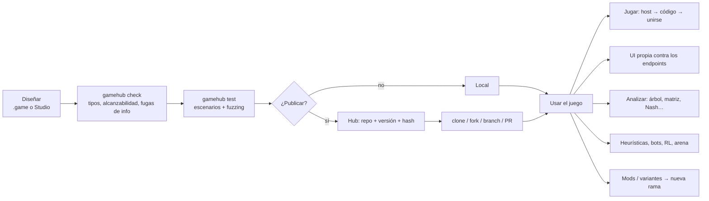

# Visión de GameHub

> **En una frase:** GameHub es a los juegos lo que GitHub es al código: un sitio donde los juegos se
> *especifican* con precisión matemática, se *versionan* y *bifurcan*, se *ejecutan* como una API,
> se *juegan* desde cualquier interfaz y se *estudian* con teoría de juegos, heurísticas e IA.

---

## 1. El problema

Hoy, quien quiere trabajar con un juego "en serio" tiene que reescribirlo una y otra vez:

- El diseñador lo describe en lenguaje natural (reglamentos ambiguos, llenos de excepciones).
- El programador lo reimplementa a mano para cada propósito: una versión para jugar online, otra
  para entrenar un bot, otra para calcular equilibrios, otra para la interfaz…
- Cada reimplementación introduce discrepancias. Nadie sabe con certeza qué "versión de las reglas"
  usó un bot, un análisis o una partida.
- Las herramientas existentes cubren trozos sueltos: OpenSpiel (algoritmos), Ludii (descripción
  de juegos), Gambit (equilibrios), boardgame.io / Board Game Arena (multijugador), Tabletop
  Simulator (mesa virtual sin reglas formales). Ninguna une *especificación + ejecución +
  análisis + colaboración*.

## 2. La propuesta

**Una única especificación formal del juego, de la que se deriva todo lo demás.**

```
                         ┌──────────────────────────────┐
  Texto .game  ────────► │                              │ ──► Motor (Python / C++ / WASM)
  Editor visual ───────► │   GameIR (fuente de verdad)  │ ──► Servidor de partidas (API)
  API Python (builder) ─►│   JSON canónico + hash       │ ──► Análisis (árbol, Nash, CGT…)
                         │                              │ ──► Entornos RL / bots / arena
                         └──────────────────────────────┘ ──► Reglamento autogenerado, SDKs, UI
```

GameHub tiene cuatro capas:

| Capa | Qué hace | Ejemplos |
|---|---|---|
| **Especificar** | Diseñar el juego con precisión absoluta | Lenguaje `.game`, Studio (editor de diagramas), API Python |
| **Ejecutar** | El juego se comporta como una API pura de entradas/salidas | Motor de referencia, motor C++, servidor de salas, protocolo |
| **Jugar** | Cualquier interfaz se conecta a los endpoints | UI genérica automática, UI kit, SDKs TS/Python/Godot, LAN y online |
| **Estudiar y competir** | Matemáticas e inteligencia sobre el juego | Minimax, Nash, Pareto, CGT, heurísticas, RL, arena de bots |

Y una capa transversal: **Colaborar** (el "GitHub"): publicar, clonar, bifurcar (*fork*), ramas,
*pull requests* con diff semántico de reglas, versiones con hash, registro de paquetes.

## 3. Flujo de usuario



## 4. Principios de diseño

1. **Una sola fuente de verdad.** La *GameIR* (representación intermedia canónica en JSON) es el
   juego. El texto `.game` y el diagrama de flujo son dos *vistas* editables de la misma IR, con
   ida y vuelta sin pérdidas.
2. **Las reglas son datos, no código arbitrario.** El lenguaje de expresiones es puro, tipado y
   con bucles acotados. Consecuencias: el juego es portable (Python, C++, navegador), seguro de
   ejecutar en un servidor y *analizable* (se puede razonar sobre él estáticamente).
3. **Determinismo total.** Mismas reglas + mismos parámetros + misma semilla + mismas acciones ⇒
   misma partida, bit a bit. Esto da replays, tests, depuración con viaje en el tiempo y
   verificación cruzada entre motores.
4. **La información es de primera clase.** Quién sabe qué y cuándo se declara en el modelo, no se
   programa a mano. Las vistas por jugador se derivan automáticamente y el servidor nunca envía a
   un cliente información que no le corresponde.
5. **El azar es explícito y visible.** Solo los nodos de azar introducen aleatoriedad, con
   distribuciones conocidas. En el diagrama se ve dónde entra la suerte.
6. **El juego es una API.** Servidor autoritativo + protocolo estándar. La interfaz gráfica es
   intercambiable: genérica, oficial o hecha por terceros en cualquier tecnología.
7. **Modularidad radical.** Biblioteca estándar (barajas, dados, tableros, bazas, apuestas),
   `import`, herencia/parches para mods (`extends` / `override`) y combinadores de juegos
   (`repeat`, `best_of`, suma de juegos…).
8. **Analizable por diseño.** Cada juego se clasifica automáticamente (información perfecta,
   azar, simultaneidad, suma cero…) y un *asesor de viabilidad* estima si un cálculo es factible
   antes de lanzarlo.
9. **Todo artefacto se ata a un hash de reglas.** Bots, replays, análisis, ratings e interfaces
   referencian la versión exacta de las reglas con las que se hicieron.
10. **Local-first.** Todo funciona sin la nube: CLI, Studio local, partidas en LAN. El hub online
    es una capa opcional de colaboración.
11. **Escalera de rendimiento.** Motor de referencia en Python (claridad) → VM en C++ (velocidad)
    → generación de código nativo para juegos "calientes" — siempre verificados entre sí.
12. **Interoperabilidad antes que reinvención.** Exportar a OpenSpiel, Gambit y PettingZoo da
    acceso inmediato a décadas de algoritmos; lo propio se construye donde aporta valor.

## 5. Qué NO es GameHub (no-objetivos)

- **No es un motor de videojuegos** con física, render 3D o tiempo continuo. GameHub modela juegos
  de **estados discretos** (incluidos juegos de velocidad con acciones discretas con marca de
  tiempo). Godot, Unity o un navegador pueden ser la *interfaz* de un juego GameHub.
- **No es una mesa virtual sin reglas** (como Tabletop Simulator): aquí el motor *conoce y aplica*
  las reglas.
- **No ejecuta código arbitrario dentro de las reglas.** Los "plugins nativos" existen como vía de
  escape para rendimiento, pero son puros, con firma declarada y ejecutados en sandbox.

## 6. Arte previo y posicionamiento

| Proyecto | Qué aporta | Qué le falta respecto a GameHub |
|---|---|---|
| **OpenSpiel** (DeepMind) | API de juegos + decenas de algoritmos (CFR, MCTS, AlphaZero…) | Juegos escritos a mano en C++/Python; sin lenguaje de diseño ni colaboración ni multijugador |
| **Ludii** (Digital Ludeme Project) | Lenguaje de *ludemas*, >1000 juegos de tablero | Poco foco en cartas/info oculta/teoría de juegos clásica; sin API multijugador abierta |
| **GDL / GDL-II** (Stanford GGP) | Lenguaje lógico formal de juegos, con info incompleta (GDL-II) | Muy lento de ejecutar, difícil de escribir para humanos |
| **Gambit** | Formatos `.efg`/`.nfg` y solvers de equilibrios | Solo análisis de juegos pequeños; no ejecución/juego |
| **boardgame.io / BGA Studio** | Máquinas de estados de turnos, multijugador, `playerView` | Reglas en código JS/PHP; no analizables; sin especificación formal |
| **PettingZoo / Gymnasium / RLCard** | API estándar para RL multiagente | Solo la interfaz de entrenamiento |
| **CGSuite** | Teoría combinatoria de juegos | Nicho; sin ejecución general |

**Posicionamiento:** *Ludii/GDL (especificación) × OpenSpiel/Gambit (algoritmos) ×
boardgame.io (multijugador) × GitHub (colaboración) × editor de statecharts (diseño visual).*

## 7. A quién sirve

- **Diseñadores de juegos:** prototipar reglas, detectar bucles infinitos, reglas muertas,
  ventajas del primer jugador, estrategias dominantes — antes de imprimir una sola carta.
- **Investigadores (teoría de juegos, IA):** un catálogo enorme de juegos formalmente idénticos
  en todos los motores, listos para algoritmos.
- **Desarrolladores de interfaces:** construir la UI que quieran sin reimplementar reglas.
- **Jugadores y comunidades:** jugar cualquier juego/variante con amigos por LAN u online.
- **Docentes:** enseñar teoría de juegos con juegos reales y visualizaciones interactivas.

Ver también: [Ideas y mejoras](ideas-y-mejoras.md) · [Modelo formal](modelo-formal.md) ·
[Roadmap](roadmap.md)
