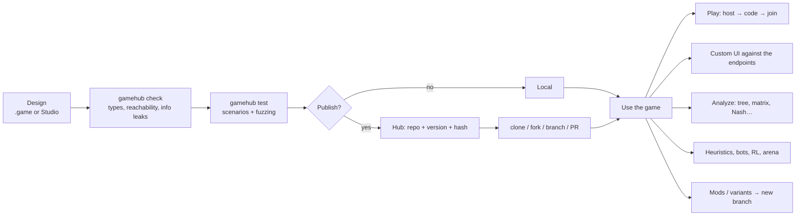

# GameHub vision

> **In one sentence:** GameHub is to games what GitHub is to code: a place where games are
> *specified* with mathematical precision, *versioned* and *forked*, *run* as an API, *played*
> from any interface and *studied* with game theory, heuristics and AI.

---

## 1. The problem

Today, anyone who wants to work with a game "seriously" has to rewrite it again and again:

- The designer describes it in natural language (ambiguous rulebooks, full of exceptions).
- The programmer reimplements it by hand for each purpose: one version to play online, another
  to train a bot, another to compute equilibria, another for the interface…
- Every reimplementation introduces discrepancies. Nobody knows for sure which "version of the
  rules" a bot, an analysis or a match used.
- Existing tools cover separate pieces: OpenSpiel (algorithms), Ludii (game description), Gambit
  (equilibria), boardgame.io / Board Game Arena (multiplayer), Tabletop Simulator (virtual table
  without formal rules). None of them brings together *specification + execution + analysis +
  collaboration*.

## 2. The proposal

**A single formal specification of the game, from which everything else is derived.**

```
                         ┌──────────────────────────────┐
  .game text  ─────────► │                              │ ──► Engine (Python / C++ / WASM)
  Visual editor ───────► │   GameIR (source of truth)   │ ──► Match server (API)
  Python API (builder) ─►│   canonical JSON + hash      │ ──► Analysis (tree, Nash, CGT…)
                         │                              │ ──► RL environments / bots / arena
                         └──────────────────────────────┘ ──► Generated rulebook, SDKs, UI
```

GameHub has four layers:

| Layer | What it does | Examples |
|---|---|---|
| **Specify** | Design the game with absolute precision | `.game` language, Studio (diagram editor), Python API |
| **Run** | The game behaves as a pure input/output API | Reference engine, C++ engine, room server, protocol |
| **Play** | Any interface connects to the endpoints | Automatic generic UI, UI kit, TS/Python/Godot SDKs, LAN and online |
| **Study and compete** | Mathematics and intelligence on top of the game | Minimax, Nash, Pareto, CGT, heuristics, RL, bot arena |

And one cross-cutting layer: **Collaborate** (the "GitHub"): publish, clone, fork, branches, pull
requests with a semantic diff of the rules, hashed versions, package registry.

## 3. User flow



## 4. Design principles

1. **A single source of truth.** The *GameIR* (canonical intermediate representation in JSON) is
   the game. The `.game` text and the flow diagram are two editable *views* of the same IR, with
   lossless round trips.
2. **Rules are data, not arbitrary code.** The expression language is pure, typed and has bounded
   loops. Consequences: the game is portable (Python, C++, browser), safe to run on a server and
   *analyzable* (it can be reasoned about statically).
3. **Total determinism.** Same rules + same parameters + same seed + same actions ⇒ the same
   match, bit for bit. This gives replays, tests, time-travel debugging and cross-checking between
   engines.
4. **Information is first-class.** Who knows what and when is declared in the model, not
   programmed by hand. Per-player views are derived automatically and the server never sends a
   client information it is not entitled to.
5. **Chance is explicit and visible.** Only chance nodes introduce randomness, with known
   distributions. The diagram shows where luck comes in.
6. **The game is an API.** Authoritative server + standard protocol. The graphical interface is
   interchangeable: generic, official or made by third parties with any technology.
7. **Radical modularity.** Standard library (decks, dice, boards, tricks, betting), `import`,
   inheritance/patches for mods (`extends` / `override`) and game combinators (`repeat`,
   `best_of`, sums of games…).
8. **Analyzable by design.** Every game is classified automatically (perfect information, chance,
   simultaneity, zero-sum…) and a *feasibility advisor* estimates whether a computation is
   tractable before launching it.
9. **Every artifact is tied to a rules hash.** Bots, replays, analyses, ratings and interfaces
   reference the exact version of the rules they were made with.
10. **Local-first.** Everything works without the cloud: CLI, local Studio, LAN matches. The online
    hub is an optional collaboration layer.
11. **Performance ladder.** Reference engine in Python (clarity) → C++ VM (speed) → native code
    generation for "hot" games — always cross-checked against each other.
12. **Interoperability before reinvention.** Exporting to OpenSpiel, Gambit and PettingZoo gives
    immediate access to decades of algorithms; our own pieces are built where they add value.

## 5. What GameHub is NOT (non-goals)

- **It is not a video game engine** with physics, 3D rendering or continuous time. GameHub models
  **discrete-state** games (including speed games with discrete, timestamped actions). Godot, Unity
  or a browser can be the *interface* of a GameHub game.
- **It is not a virtual table without rules** (like Tabletop Simulator): here the engine *knows and
  enforces* the rules.
- **It does not run arbitrary code inside the rules.** "Native plugins" exist as an escape hatch
  for performance, but they are pure, have a declared signature, run sandboxed and always come
  with a reference implementation in Nomos.

## 6. Prior art and positioning

| Project | What it brings | What it lacks compared to GameHub |
|---|---|---|
| **OpenSpiel** (DeepMind) | Game API + dozens of algorithms (CFR, MCTS, AlphaZero…) | Games hand-written in C++/Python; no design language, collaboration or multiplayer |
| **Ludii** (Digital Ludeme Project) | *Ludeme* language, >1000 board games | Little focus on cards/hidden information/classical game theory; no open multiplayer API |
| **GDL / GDL-II** (Stanford GGP) | Formal logical game language, with incomplete information (GDL-II) | Very slow to run, hard for humans to write |
| **Gambit** | `.efg`/`.nfg` formats and equilibrium solvers | Analysis of small games only; no execution or play |
| **boardgame.io / BGA Studio** | Turn state machines, multiplayer, `playerView` | Rules in JS/PHP code; not analyzable; no formal specification |
| **PettingZoo / Gymnasium / RLCard** | Standard API for multi-agent RL | Only the training interface |
| **CGSuite** | Combinatorial game theory | Niche; no general execution |

**Positioning:** *Ludii/GDL (specification) × OpenSpiel/Gambit (algorithms) × boardgame.io
(multiplayer) × GitHub (collaboration) × a statechart editor (visual design).*

## 7. Who it is for

- **Game designers:** prototype rules, detect infinite loops, dead rules, first-player advantages
  and dominant strategies — before printing a single card.
- **Researchers (game theory, AI):** a huge catalog of games that are formally identical across
  all engines, ready for algorithms.
- **Interface developers:** build whatever UI they want without reimplementing rules.
- **Players and communities:** play any game or variant with friends over LAN or online.
- **Teachers:** teach game theory with real games and interactive visualizations.

See also: [Ideas and improvements](ideas.md) · [Formal model](formal-model.md) ·
[Roadmap](roadmap.md)
