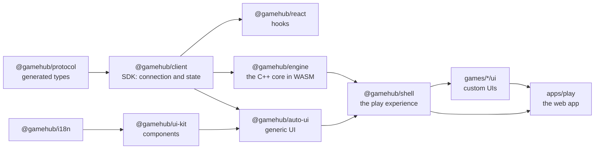

# Web client: playing in the browser

> Status: **implemented** (Phase 4, 2026-10-10; custom UIs for the second catalog wave in
> Phase 6). Code: [`web/`](../../web) and the custom UIs in [`games/*/ui`](../../games). Protocol:
> [protocol](protocol.md). Presentation hints: [language](language.md) §12.

Any GameHub game can be played in the browser, on a computer or a phone, without writing an
interface: the **generic UI** draws it from its IR. A game can also have a **custom UI**, made
from the template in less than an hour, which the app uses instead.

## 1. How to use it

```bash
pnpm install && pnpm build                       # once: the web app (at the repository root)
cd python && uv run gamehub serve ../games --open    # the match server serves the app
```

- **`gamehub serve`** and **`gamehub host`** serve the app (`--no-web` to skip it, `--open` opens
  the browser). Each room's link (`http://192.168.1.20:7420/r/K7FQ2P`) and its QR code open the
  app: from a phone, scanning it is enough. The Python wheel ships the built app.
- **Home**: join with a code, create a room for any game on the server (players, game options,
  clock, spectators, bots), open rooms and recent matches.
- **Room**: you join as a player or as a spectator; the session is stored, so reloading takes you
  back to the same seat. In the lobby: code, link and QR code to invite people, seats (sit down,
  stand up; the host adds bots, frees seats or kicks people out), the host's settings, "I'm
  ready", chat and the provably-fair commitment. At the end, the result, the replay and the
  rematch.
- **Match**: the game's custom UI if it has one (with a button to switch to the generic one) or
  the generic one; resigning; a notice if the connection drops (it reconnects by itself) or if the
  room is opened in another tab.
- **Replays** (`/replay/ID`): the match state by state, from the perspective of any seat, a
  spectator or with everything visible; play, step by step or with the keyboard.
- **On this device** (`/local/GAME`): several people taking turns on the same screen (with bots
  at random, rule-based with the game's heuristic and, in games without hidden information, MCTS
  and alpha-beta; with hidden information, ISMCTS and PIMC, which only use what their seat sees;
  F9). If several people share a game with
  hidden information, the screen is covered between turns ("Ana's turn: pass her the device").
  It runs **in the browser** with the C++ core in WebAssembly (`@gamehub/engine`, ADR-082): a
  `LocalTable` produces the room protocol's messages, so the UIs are the same; if the engine
  cannot load, it falls back to a room on the server with one connection per seat.
- **Kit gallery** (`/kit`): every component, to see them at a glance.
- Spanish and English (the choice is remembered), light or dark theme, and a layout that adapts
  to phones.

## 2. Packages



| Package | What it does |
|---|---|
| `@gamehub/protocol` | Types for every message, generated from the JSON Schema by the same generator as the Python ones (`gamehub protocol types`); room codes |
| `@gamehub/client` | `GameClient`: WebSocket (browser or Node 22), requests with replies, reconnection with `resume`, heartbeat, unique ids, resync; immutable state with a pure reducer; legal and progressive actions; sessions in localStorage; REST API |
| `@gamehub/react` | `GameClientProvider`, `useView<State>()`, `useLegalActions()`, `useAct()`… on top of `useSyncExternalStore` |
| `@gamehub/i18n` | Translatable texts from the IR, es/en catalogs checked by TypeScript, remembered language |
| `@gamehub/ui-kit` | Grid, card, fanned hand, pile, deck, die, token, track, graph, player badge, scoreboard, counter, betting chips, clock, action bar; all with `--gh-…` CSS variables (light and dark themes) |
| `@gamehub/auto-ui` | The generic UI (§3) |
| `@gamehub/engine` | The [C++ core](core.md) compiled to WebAssembly (`gamehub wasm`): games and sessions from the IR, the stdlib's native plugins, the Studio's playouts and `LocalTable`, which hosts matches in the page speaking the room protocol (ADR-082) |
| `@gamehub/shell` | Home, create room, room, match, replays and local matches, as a library: used by the app and by each custom UI's development server |
| `apps/play` | The app (Vite) served by the server; it registers the UIs in `games/*/ui` by itself |

The pnpm workspace lives at the repository root and includes `web/packages/*`, `web/apps/*` and
`games/*/ui`. Stack: Node 22, strict TypeScript 7, React 19, Vite 8, Biome (lint and formatting),
Vitest; exact versions in the catalog of `pnpm-workspace.yaml` ([ADR-044](decisions.md)).

## 3. The generic UI

It draws everything from the IR, the view of each update and the legal actions:

- **Each state variable according to its type**: grid → board; a seat's zone or bag → hand
  (other players', face down with their size); shared zone → row (or deck if nobody sees it);
  numbers → counter; seat → the player; enums → their name, symbol or color; structs with `rank`
  and `suit` (or with the `card` hint) → playing cards. `per_player` variables go in each seat's
  panel (with its clock and, at the end, its place); the rest, on the table. What nobody ever sees
  (visibility `none`) is not drawn.
- **Each action argument according to its domain**: `cells(G)` → click a square of grid G;
  `subsets(items(Z), a, b)` → mark from a to b items of zone Z and confirm; `items(Z)` → click
  one; the rest (numbers, enums…) → buttons or, if there are many, a list. The `ui` hints
  (`column(board)`, `pick(hand)`…) say so when the domain is not enough.
- **The action builder** picks the arguments in the order they are declared, with the possible
  values given by the legal actions: enumerated or, if there are too many (more than 500 by
  default), progressive with `query_actions`. The possible values are computed once per update.
  To mark several items with progressive actions it is enough to respect the domain's size,
  without asking for the list of every subset; the server rejects whatever is not valid.
- **Status bar** (node, "Your turn", whose turn it is or who is being waited for), an **event log**
  in sentences (es/en, with the move before what it causes) and the **result** with places and
  payoffs.

The game's [`ui { … }` hints](language.md) provide translated names, symbols, colors, cards, dice
and tokens, hide auxiliary variables and say where each thing goes. All 22 catalog packages have
them ([ADR-047](decisions.md), [ADR-048](decisions.md)).

## 4. Custom UIs in less than an hour

From the repository root:

```bash
cd python && uv run gamehub ui new ../games/my-game && cd ..    # creates games/my-game/ui
pnpm install                                                     # links it with the packages
cd python && uv run gamehub serve ../games                       # the server (another terminal)
cd games/my-game/ui && pnpm dev                                  # the app with only that game
```

The template brings:

- `src/game.ts`: the **game's types** (`gamehub sdk ts`): the state as seen (what may arrive
  hidden, as `Hidden`), the actions, the options and the nodes. If the rules change, `pnpm types`
  regenerates them and TypeScript points at what needs to be touched; a test checks that those of
  the catalog UIs are up to date.
- `src/Board.tsx`: a starting board that **already works** (the state as is and one button per
  legal action), to be changed step by step. It receives `view`, `actions` (the legal ones,
  typed), `act`, `seat`, `players`, `log`, `clocks`, `params`…
- `src/index.tsx` (`defineGameUi`), styles, a test with Testing Library and the development
  server with hot reload.

Typical steps: draw the state with the kit (`Grid`, `PlayingCard`, `Hand`, `Die`, `Token`…), turn
the legal actions into gestures (click, drag, mark) and add what the generic UI does not know
(the winning line, animations, a summary). Examples, made with the template:

| UI | What it adds | Size |
|---|---|---|
| [Tic-tac-toe](../../games/tictactoe/ui) | Marks drawn in SVG with animation, winning line, a preview of your mark | 177 lines + 160 of CSS |
| [Connect Four](../../games/connect-four/ui) | Blue board, falling discs, highlighted column with the disc that would fall, winning line | 153 lines + 153 of CSS |
| [Dudo](../../games/dudo/ui) | The bid on the felt, the round's history, other players' cups with their dice covered, a summary of the last challenge, a bid selector with dice | 268 lines + 183 of CSS |
| [Chess](../../games/chess/ui) (F6) | Board flipped for Black, legal destinations when a piece is clicked, promotion piece choice, last move and king in check highlighted, captured pieces and move list | 363 lines + 221 of CSS |
| [Texas Hold'em](../../games/texas-holdem/ui) (F6) | A felt table with the players around it, chips and the round's bets, the button, community cards and the pot; fold, check or call, and bet or raise with a slider and shortcuts (minimum, half pot, pot, all-in) | 327 lines + 206 of CSS |
| [Wizard](../../games/wizard/ui) (F6) | Trump card, the trick in play and the last one (taken from the log), each player's bid, tricks and points, one button per possible bid, unplayable cards dimmed, choosing trump when a wizard comes up | 231 lines + 132 of CSS |
| [Parchís](../../games/parchis/ui) (F6) | Cross-shaped 68-square board in SVG (safe squares, exits, home columns, nests and goal), movable pawns highlighted and keyboard accessible, die, bonus and sixes in a row | 269 lines + 149 of CSS + 101 of geometry |

The web app registers the UIs in `games/*/ui` by itself when it is built ([ADR-050](decisions.md)).

## 5. Tests

- **SDK against the real Python server**: two clients play with a dropped connection and a
  spectator; progressive actions.
- **Generic UI acceptance**: each of the 22 catalog packages is played to the end against the
  server only by clicking UI controls, at random with a seed (Skat, Solitaire, Hold'em and Wizard
  with shorter options so that the test does not take minutes).
- **Browser against terminal**: Ana plays in the app and Luis with `gamehub join` in a real
  terminal, until the end.
- **A room with the app**: join, sit down, add a bot, play and see the result; watch a match
  between two bots as a spectator.
- Components, action builder, forms, routes, custom UIs, type generator (with Biome's formatting)
  and template.

Integration tests start `gamehub serve` with uv (`GAMEHUB_SKIP_SERVER_TESTS=1` skips them). In
jsdom, clients use the WebSocket from the `ws` package: the simulated browser's one (undici)
clashes with jsdom's `Event` class.

## 6. Pending

- Animating changes from events (cards flying from one zone to another).
- Replays without a server and an installable app (PWA) on top of the in-browser engine.
- More ways of drawing in the hints (tracks, graphs, dice as an argument).
- An accessibility review with a screen reader and keyboard of the seven custom UIs.
- Custom UIs for Skat and Solitaire (today, the generic one).
